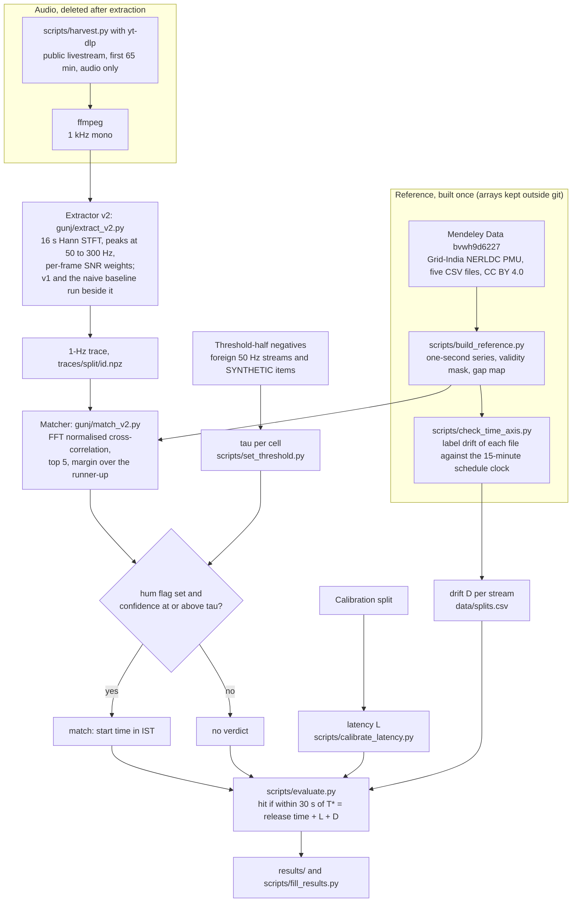

# Gunj


The stream in this screenshot is from the Calibration split, which was used to set the start latency L, so its lock is not a blind Test result.

Gunj dates Indian recordings from mains hum. It extracts the hum's frequency once per second and searches a public one-second log of India's grid frequency for the moment that trace fits.

Solo entry by Shrey Sati (GitHub satanrayshe) to Threws Odyssey 2026, Cybersecurity track. Explorer: https://satanrayshe.github.io/gunj/. Video: [pending: video link].

> [!IMPORTANT]
> **What Gunj does**
> - Estimates when a recording started, in IST and to the second, if the recording carries mains hum and was made inside the reference period (<!-- span:start -->20 Dec 2020 to 20 Aug 2023<!-- span:end -->).
> - Lists the five best candidate start times with their correlations, and a confidence: the margin of the best candidate over the best one at least 60 s away.
> - Says "no verdict" when there is no hum, or when the confidence is below a threshold that was fixed on held-out negatives before any Test search.
>
> **What Gunj does not do**
> - It does not locate a recording. India runs one synchronous grid, so the hum's frequency is the same across the country at any moment. Gunj reports time and grid only.
> - It cannot date a recording made after the reference ends (<!-- span-end:start -->20 Aug 2023<!-- span-end:end -->) or on another country's grid.
> - It does not prove that a recording is genuine. A match is evidence of when the hum was recorded. A missing hum is evidence of nothing. Someone with the grid log could add a matching hum.
> - It does not publish audio. The repo keeps only video IDs, file hashes and derived 1-Hz traces, and downloaded audio is deleted after extraction (Ethics lists the one exception).

## Results

Every number in this section is written by `scripts/fill_results.py` from the file named beside it. Re-run it after `scripts/evaluate.py` and the numbers update.

<!-- status:start -->
- Gate (PROTOCOL section 15, decision time 8 Nov 2026 14:00 IST): **not met**, frozen 8 Nov 2026, 17:04 IST (`results/gate_frozen.json`).
- Test numbers are from `results/evaluation.json` and `results/test_results.csv`, written by `scripts/evaluate.py` at 8 Nov 2026, 17:04 IST: 126 of 150 selected streams had a trace then. The harvest can still add streams; `scripts/fill_results.py` re-reads the files each time it runs.
- The reference, label-drift, latency, threshold, Dev and uniqueness results were measured before any Test search and do not change.
<!-- status:end -->

<!-- results:start -->
### Gate (PROTOCOL section 15)

- **Gate not met** (frozen 8 Nov 2026, 17:04 IST, `results/gate_frozen.json`).
- Conditions 1 and 2: 38 of N = 126 Test streams harvested by the decision time locked blind (5 needed): extractor v2, top candidate in the full span or ±90 days within 30 s of T* for at least one excerpt length, with confidence at or above tau of that cell. Met.
- The same count without the label-drift correction (S1, D = 0): 9.
- Condition 3, harvest health: not met. tau and L committed by the decision time: yes.
- Locks with the baselines on the same streams (description only): v1 19; naive 13.
- `results/gate.md` lists every processed stream, hits and misses.

### Test split, pre-registered and blind

| result | value | source |
|---|---|---|
| M1 hum present (extractor v1, all downloaded audio; Test streams with audio) | 50/126 (39.7%, 95% CI 31.6 to 48.4%) | `results/test_results.csv` |
| M2 primary endpoint: top-1 start within 30 s of T*, v2, 60-min excerpts, full span | 25/90 (27.8%, 95% CI 19.6 to 37.8%) | `results/evaluation.json` |
| Same cell: confident hit (hum flag set and confidence at or above tau, within 30 s) | 14/90 (15.6%, 95% CI 9.5 to 24.4%) | `results/evaluation.json` |
| Same cell: confident wrong (verdict match, more than 30 s off) | 9/90 (10.0%, 95% CI 5.4 to 17.9%) | `results/evaluation.json` |
| Same cell: no verdict | 67/90 (74.4%, 95% CI 64.6 to 82.3%) | `results/evaluation.json` |
| Same cell, M1 hum-present streams only: top-1 within 30 s | 16/37 (43.2%, 95% CI 28.7 to 59.1%) | `results/evaluation.json` |
| v2, 60 min, ±90 days: top-1 within 30 s | 25/90 (27.8%, 95% CI 19.6 to 37.8%) | `results/evaluation.json` |
| M3 false matches at tau, report-half negatives, v2, 60 min, full span: real foreign 50 Hz streams | n/a (N = 0) | `results/evaluation.json` (`m3`; also `results/false_matches.md`) |
| M3 false matches at tau, report-half negatives, v2, 60 min, full span: SYNTHETIC noise and hum | 0/20 (0.0%, 95% CI 0.0 to 16.1%) | `results/evaluation.json` (`m3`; also `results/false_matches.md`) |
| M3 false matches at tau, report-half negatives, v2, 60 min, full span: real and SYNTHETIC together | 0/20 (0.0%, 95% CI 0.0 to 16.1%) | `results/evaluation.json` (`m3`; also `results/false_matches.md`) |
| M5 edit detection on SYNTHETIC cuts | [pending: M5 not computed yet; the SYNTHETIC cut traces exist] | PROTOCOL section 11 |
| M6 live station (optional) | not run | PROTOCOL section 11 |

M3 used 0 of 25 real and 20 of 20 SYNTHETIC report-half negatives (`results/evaluation.json`, `m3_counts`). Every cell, with and without the hum-flag condition, is in `results/false_matches.md`.

### M2 top-1 within 30 s, extractor v2 (Wilson 95%; `results/evaluation.json`)

| excerpt | full span | ±90 days | ±1 day |
|---|---|---|---|
| 10 min | 28/126 (22.2%, 95% CI 15.8 to 30.2%) | 28/126 (22.2%, 95% CI 15.8 to 30.2%) | 35/126 (27.8%, 95% CI 20.7 to 36.2%) |
| 20 min | 31/126 (24.6%, 95% CI 17.9 to 32.8%) | 31/126 (24.6%, 95% CI 17.9 to 32.8%) | 40/126 (31.7%, 95% CI 24.3 to 40.3%) |
| 40 min | 26/104 (25.0%, 95% CI 17.7 to 34.1%) | 26/104 (25.0%, 95% CI 17.7 to 34.1%) | 30/104 (28.8%, 95% CI 21.0 to 38.2%) |
| 60 min | 25/90 (27.8%, 95% CI 19.6 to 37.8%) | 25/90 (27.8%, 95% CI 19.6 to 37.8%) | 28/90 (31.1%, 95% CI 22.5 to 41.3%) |

Confident wrong (verdict match, more than 30 s off), same cells:

| excerpt | full span | ±90 days | ±1 day |
|---|---|---|---|
| 10 min | 2/126 (1.6%, 95% CI 0.4 to 5.6%) | 2/126 (1.6%, 95% CI 0.4 to 5.6%) | 2/126 (1.6%, 95% CI 0.4 to 5.6%) |
| 20 min | 2/126 (1.6%, 95% CI 0.4 to 5.6%) | 2/126 (1.6%, 95% CI 0.4 to 5.6%) | 2/126 (1.6%, 95% CI 0.4 to 5.6%) |
| 40 min | 8/104 (7.7%, 95% CI 3.9 to 14.4%) | 9/104 (8.7%, 95% CI 4.6 to 15.6%) | 7/104 (6.7%, 95% CI 3.3 to 13.2%) |
| 60 min | 9/90 (10.0%, 95% CI 5.4 to 17.9%) | 8/90 (8.9%, 95% CI 4.6 to 16.6%) | 7/90 (7.8%, 95% CI 3.8 to 15.2%) |

### Baselines on the same streams, 60 min, full span

| method | top-1 within 30 s | confident hit | confident wrong | paired with v2 on the same streams (both hit / v2 only / baseline only / neither) |
|---|---|---|---|---|
| v2 (primary) | 25/90 (27.8%, 95% CI 19.6 to 37.8%) | 14/90 (15.6%, 95% CI 9.5 to 24.4%) | 9/90 (10.0%, 95% CI 5.4 to 17.9%) |  |
| v1 (frozen extractor) | 15/90 (16.7%, 95% CI 10.4 to 25.7%) | 11/90 (12.2%, 95% CI 7.0 to 20.6%) | 4/90 (4.4%, 95% CI 1.7 to 10.9%) | 15 / 10 / 0 / 65 (n = 90) |
| naive single-bin 50 Hz | 12/90 (13.3%, 95% CI 7.8 to 21.9%) | 8/90 (8.9%, 95% CI 4.6 to 16.6%) | 2/90 (2.2%, 95% CI 0.6 to 7.7%) | 12 / 13 / 0 / 65 (n = 90) |
| libhum | [pending: libhum baseline not run yet; PROTOCOL section 12] | | | |
| random guess (analytic) | p = 7.258 × 10^-7 per stream; expected chance hits over these 90 streams: 6.5 × 10^-5 | | | |

Sources: `results/evaluation.json` (rates), `results/test_results.csv` (pairs), `results/splits_summary.json` (random guess).

### Sensitivity analyses (PROTOCOL section 13), v2, 60 min, full span

| analysis | top-1 within 30 s | source |
|---|---|---|
| as pre-registered (T* = release time + L + D) | 25/90 (27.8%, 95% CI 19.6 to 37.8%) | `results/evaluation.json` |
| S1: no label-drift correction (D = 0) | 5/90 (5.6%, 95% CI 2.4 to 12.4%) | `results/evaluation.json` |
| S2: label-stable streams only | 9/25 (36.0%, 95% CI 20.2 to 55.5%) | `results/test_results.csv`, `label_stable` |
| S3: verified channels only | 22/75 (29.3%, 95% CI 20.2 to 40.4%) | `results/test_results.csv`, `channel_status` |
| S4: v1 against v2 | see the paired column above | `results/test_results.csv` |

### M1 hum presence by venue type (`results/test_results.csv`)

| venue type | hum present |
|---|---|
| conference | 0/1 (0.0%, 95% CI 0.0 to 79.3%) |
| government event | 6/25 (24.0%, 95% CI 11.5 to 43.4%) |
| lecture | 5/29 (17.2%, 95% CI 7.6 to 34.5%) |
| legislature | 28/52 (53.8%, 95% CI 40.5 to 66.7%) |
| religious | 11/19 (57.9%, 95% CI 36.3 to 76.9%) |
| all | 50/126 (39.7%, 95% CI 31.6 to 48.4%) |

### Flow, Test streams (`results/evaluation.json`; drop reasons in `results/flow_table.md`)

| step | streams |
|---|---|
| selected | 150 |
| download attempted | 145 |
| audio obtained | 126 |
| trace extracted (v2) and searched | 126 |
| hum present (M1) | 50 |
| match (v2, any length, full or +-90 d) | 30 |
| hit (confident hit) | 25 |

### Measured before any Test search

- **Reference** (`results/reference_stats.json`): 2020-12-20 17:21:01 to 2023-08-20 11:33:05 IST, 84,046,325 seconds (972.76 days), 83,273,631 valid (99.08%). 61 gaps longer than 10 s hold 772,056 missing seconds; the longest runs from 2021-09-11 13:22:38 to 2021-09-16 10:10:15 (420,458 s).
- **The reference's time labels drift** (`results/time_axis_check.json`). Checked against the grid's 15-minute scheduling clock, each file's labels run late by the end of the file: I 172 s, II 64 s, III 319 s, IV 198 s, V 224 s. Where two files overlap they label the same values 172 s, 64 s, 319 s, 198 s apart (I-II, II-III, III-IV, IV-V), and the clock check gives the same four offsets within 1 s. Gunj therefore corrects every stream by its own drift estimate D. For 93 of the 150 Test streams |D| is over 30 s, wider than the hit window itself (median |D| 58 s, largest 319 s; `results/splits_summary.json`). 39 Test streams are label-stable (S2).
- **Latency L** (`results/latency.json`, Calibration split only): L = 2 s (calibrated), the median offset o of the 5 Calibration streams of 19 harvested (20 selected) that locked with confidence at or above tau and |o| ≤ 600 s. Their o runs from -4 s to 5 s (IQR 0 s to 2 s). The range is within the 60 s that PROTOCOL section 6 allows for one constant latency. Streams that count, by extractor (`results/calibration.json`): v2 5, v1 2, naive 1 of 19.
- **Hum on the Calibration split** (description only, `results/calibration.json`): v1 hum flag on 7/19 (36.8%, 95% CI 19.1 to 59.0%) harvested streams.
- **Threshold tau** (`results/threshold.json`): set per extractor, excerpt length and scope on the threshold half of the negatives, 23 real foreign 50 Hz streams and 20 SYNTHETIC items (2 real ones could not be downloaded). v2, 60 min: full span 0.0834, ±90 days 0.1412, ±1 day 0.2334.
  - The highest raw correlation of any real negative was r1 = 0.9951 (v2, 10 min, full span), but its confidence was only 0.0022 because its runner-up scored almost as high. Foreign recordings can correlate strongly with some stretch of the Indian log, which is why the confidence is the margin atanh(r1) - atanh(r2) over the best candidate at least 60 s away.
- **Extractor v2, tuned on the 5 Dev streams only** (`results/v2_tuning.json`; Dev is never pooled with Test): objective J = 0.222 for the chosen candidate B1, against -0.012 for v1 and -0.046 for the naive extractor.

### M4: how much audio a unique lock needs (reference only, SYNTHETIC noise)

Excerpts of the real reference, with SYNTHETIC noise added and no audio, searched like a recording. Noise level 40 mHz, the tested level nearest the 5 Nov probe's median equivalent trace noise of 38.6 mHz (`results/probe_noise.json`). `white` is independent each second; `hann16` is smoothed over 16 s like real extractor error, so it is the closer stand-in. Source: `results/uniqueness_table.csv`.

| scope | SYNTHETIC noise | shortest tested length with at least 90% unique locks | hit rate there | hits at 5, 10, 20, 40 and 60 min |
|---|---|---|---|---|
| full span | white | 20 min | 450/450 (100.0%, 95% CI 99.2 to 100.0%) | 5, 305, 450, 450, 450 of 450 |
| full span | hann16 | 40 min | 422/450 (93.8%, 95% CI 91.1 to 95.7%) | 0, 1, 121, 422, 450 of 450 |
| ±90 days | white | 20 min | 800/800 (100.0%, 95% CI 99.5 to 100.0%) | 33, 638, 800, 800, 800 of 800 |
| ±90 days | hann16 | 40 min | 776/800 (97.0%, 95% CI 95.6 to 98.0%) | 0, 6, 325, 776, 799 of 800 |
| ±1 day | white | 10 min | 1934/2000 (96.7%, 95% CI 95.8 to 97.4%) | 759, 1934, 2000, 2000, 2000 of 2000 |
| ±1 day | hann16 | 40 min | 1986/2000 (99.3%, 95% CI 98.8 to 99.6%) | 12, 362, 1627, 1986, 1999 of 2000 |
<!-- results:end -->

Plots: `results/reference_coverage.png` (reference coverage by month), `results/time_axis_check.png` (label drift per file), `results/uniqueness_curve.png` (M4).

## How it works



## Setup

Tested on Windows 11 with Python 3.12 only. There is no one-command setup: the reference has to be downloaded by hand from Mendeley Data and then built. Commands are for PowerShell, from the repo root.

**1. Install and test.**

```
python -m venv .venv
.venv\Scripts\python.exe -m pip install -e . pytest
$env:OPENBLAS_NUM_THREADS = "1"
.venv\Scripts\python.exe -m pytest
```

`pip install -e .` installs NumPy, SciPy, pandas, matplotlib and soundfile (`pyproject.toml`) and the `gunj` command. `OPENBLAS_NUM_THREADS=1` stops NumPy's OpenBLAS from reserving memory for every CPU thread; the scripts also set it themselves. Tests that need the built reference are skipped until it exists, and the harvester tests that need ffmpeg are skipped if it is not on PATH. yt-dlp is needed only to re-run the harvest (`pip install yt-dlp`). ffmpeg is needed for the harvest and for audio formats soundfile cannot read.

**2. Get and build the reference.** Download the five files `Frequency Data I.csv` to `Frequency Data V.csv` from https://data.mendeley.com/datasets/bvwh9d6227 into a folder `..\data\enf-ref` beside the repo folder, and rename them `freq_I.csv` to `freq_V.csv`. Check them against the SHA-256 values listed in `results/reference_summary.md` (`Get-FileHash ..\data\enf-ref\freq_I.csv -Algorithm SHA256`). Then:

```
.venv\Scripts\python.exe scripts\build_reference.py --ref-dir ..\data\enf-ref --derived-dir ..\data\derived
.venv\Scripts\python.exe scripts\check_time_axis.py --derived-dir ..\data\derived
```

The first command writes the one-second series, its validity mask and its source-file array to `..\data\derived` (outside git) and rewrites `results/reference_*`. The second writes `results/time_axis_check.json`, the label-drift check. `gunj` looks for the arrays in `..\data\derived`, or in the folder given by `--ref` or `$env:GUNJ_REF`.

**3. Date a recording.**

```
.venv\Scripts\gunj.exe date recording.flac
.venv\Scripts\gunj.exe date recording.flac --scope 1d --claimed 2023-03-21
.venv\Scripts\gunj.exe date recording.flac --excerpt-start 120 --excerpt-length 3600 --edits
.venv\Scripts\gunj.exe extract recording.flac --out trace.csv
```

`gunj date` prints JSON: the top five candidate start times in IST, their r, the margin and confidence, the hum statistics and a verdict. `--scope 1d --claimed DATE` checks a claimed date (the whole IST day, plus or minus one day). `--edits` looks for cuts relative to the best lock.

`gunj date` is a demonstration command and its verdicts are not the evaluated ones. It runs extractor v1 with the unweighted matcher, applies a single threshold (the largest v2 tau, <!-- cli-threshold:start -->0.4292<!-- cli-threshold:end -->, from `gunj/config.json`) and does not apply the latency L or the drift D. The evaluated pipeline (v2, one tau per cell, L and D) runs in `scripts/eval_common.py` and `scripts/evaluate.py`.

**4. Check and re-score the evaluation.** The 1-Hz traces (`traces/`), the raw search outputs (`results/search_cache/`) and the harvest manifest are in the repo, so the scoring can be re-run without any audio:

```
.venv\Scripts\python.exe scripts\make_splits.py --derived-dir ..\data\derived --verify-protocol PROTOCOL.md
.venv\Scripts\python.exe scripts\evaluate.py --workers 2
.venv\Scripts\python.exe scripts\fill_results.py
```

`make_splits.py --verify-protocol` re-draws the splits from the same inputs and seed and checks the SHA-256 values quoted in `PROTOCOL.md`. `evaluate.py` refuses to touch any Test trace unless `results/threshold.json`, `results/latency.json` and the code it runs are committed and unchanged. It re-searches only streams whose trace changed. `fill_results.py` rewrites the marked results blocks in this README and in `submission/UNSTOP-ANSWERS.md`.

The other scripts, in the order they ran: `harvest_metadata.py` (YouTube metadata only, no media), `make_splits.py`, `uniqueness.py` (M4, reference only), `harvest.py` through `run_stage3.ps1` (audio download, extraction, deletion), `tune_v2.py` (needs the Dev audio, which is not published, so it cannot be re-run from the repo), `set_threshold.py`, `calibrate_latency.py`, `evaluate.py`. Checks and one-offs: `bench_search.py`, `cli_smoke_real_ref.py`, `synthetic_checks.py` (all SYNTHETIC), `probe_noise.py`, `mem_import_check.py`, `repair_outage_attempts.py`. Re-running the harvest downloads audio from YouTube, whose terms restrict downloading; those scripts are published so the method can be read and checked.

## Method

The full pre-registered plan is in [PROTOCOL.md](PROTOCOL.md). It was approved and committed on 7 Nov 2026 at 09:05 IST, before any Test or negative audio existed (commit 2485706). In short:

- **Question.** How often does Indian online media carry a datable grid fingerprint, and how much audio does dating it take?
- **Data.** Public YouTube livestreams of Indian legislatures, lectures, government events, religious venues and conferences, drawn from metadata only with <!-- splits:start -->seed 2026110701 into Dev (5), Calibration (20) and Test (150) splits, plus 50 foreign 50 Hz streams and 40 SYNTHETIC items<!-- splits:end --> as negatives (PROTOCOL section 5). No two Test streams overlap in time.
- **Excerpts and scopes.** From the first 65 min of each stream, excerpts of 10, 20, 40 and 60 min start 120 s in. Each is searched over the full reference, over ±90 days and over ±1 day around the stream's public start time (PROTOCOL section 8).
- **Extractor.** v1 (`gunj/extract.py`): 16 s Hann windows with a 1 s hop, peaks of harmonics 1 to 6 of 50 Hz refined by quadratic interpolation, harmonics weighted by their peak-to-floor ratio, a 5-point running median. v2 (`gunj/extract_v2.py`, `gunj/match_v2.py`) adds per-frame SNR weights to the trace and the correlation. v2 was tuned on the 5 Dev streams only and frozen (git tag `extractor-v2`) before any Calibration, Test or negative audio was extracted, so it is the primary extractor (PROTOCOL sections 7 and 19).
- **Matcher.** Normalised cross-correlation computed with FFTs over every position in the scope; windows with less than 90% valid reference seconds are skipped. Confidence = atanh(r1) - atanh(r2), where r2 is the best candidate at least 60 s from the top one.
- **Threshold.** One tau per extractor, excerpt length and scope, set on the threshold half of the negatives so that at most 1% of them reach it; with fewer than 100 negatives per cell, tau sits just above the largest negative confidence (PROTOCOL section 10). A verdict "match" needs the hum flag (any harmonic's median peak-to-floor ratio at least 3) and confidence at or above tau.
- **Ground truth.** T* = YouTube's release time in IST + L + D. L is one constant start latency, estimated on the Calibration split only. D is each stream's estimated label drift of the reference at that date (next section). A hit is a top candidate within 30 s of T* (PROTOCOL sections 6 and 9).
- **Metrics.** M1 hum presence, M2 dating accuracy (primary endpoint: top-1 hit rate of v2 for 60-min excerpts over the full span), M3 false matches on the report half of the negatives, M4 the audio length needed for unique locks (SYNTHETIC noise on real reference excerpts), M5 edit detection on SYNTHETIC cuts, M6 an optional live station. Every rate has a Wilson 95% interval. Baselines: a naive single-bin 50 Hz extractor, v1, libhum, and the analytic random guess (PROTOCOL sections 11 to 13).
- **Blinding.** tau, L and `scripts/evaluate.py` were committed before any Test search ran (commits beadde1, 84ac47d and 6d010bb), and `evaluate.py` checks this with git before it reads a Test trace (PROTOCOL section 14).

**Label drift, a finding about the reference.** The dataset's time labels are not consistent. Where two files overlap they hold the same values shifted by minutes, and inside each file the labels drift late in steps, by up to <!-- drift-max:start -->319 s<!-- drift-max:end --> by the end of a file. Gunj measures this drift against the grid's own 15-minute scheduling clock: frequency changes faster just after each 15-minute block boundary, so folding the second-to-second change on time mod 900 s gives a peak whose phase moves when the labels drift (`scripts/check_time_axis.py`). Each stream's D comes from this check at the stream's start, smoothed over three weekly windows, and was frozen in `data/splits.csv` before any audio existed. The 5 Nov probe had read most of this drift as a start latency of +189 s; on corrected labels its lock sits 9 s before YouTube's start time (`results/reference_summary.md`).

## Data, licences and attributions

**Reference dataset.** Mukherjee, D., Kalita, K. and Kumar, S. (2024). *PMU-Frequency Data at 1-second Interval (December 2020- July 2024)*. Mendeley Data, version 4. https://doi.org/10.17632/bvwh9d6227.4. Licence CC BY 4.0 (https://creativecommons.org/licenses/by/4.0/). One-second grid frequency from the Grid-India NERLDC PMU at substation BALIP_PG, shared by IIT Guwahati.

- Version 4 is the version the dataset page showed on 7 Nov 2026; the version was not recorded at download time. The SHA-256 of each file used is in `results/reference_summary.md`, and the files were compared with Mendeley's published hashes before the build.
- The page title gives the period as December 2020 to July 2024. The five files used here run from <!-- span:start -->20 Dec 2020 to 20 Aug 2023<!-- span:end -->.
- Changes made: the five CSV exports were merged into one one-second float32 series; the exporter's Java error trace at the end of three files was removed; empty or non-numeric values were marked missing; where files overlap, the later file's value is used (`scripts/build_reference.py`). The built arrays are not redistributed here.

**Stream metadata and traces.** Public YouTube pages, read with yt-dlp (no sign-in, no cookies). The repo holds video IDs, titles and other public metadata (`data/`), SHA-256 hashes of the downloaded audio, and 1-Hz traces derived from it (`traces/`). No audio or video is included. <!-- test-licences:start -->Of the 150 Test streams, 3 carry a Creative Commons BY licence and 147 the standard YouTube licence<!-- test-licences:end --> (`results/splits_summary.json`).

**Software.** Every third-party library imported by `gunj/` and `scripts/`, plus the tools they call:

| software | used for | licence |
|---|---|---|
| NumPy | arrays and numerics | BSD-3-Clause |
| SciPy | FFTs (`scipy.fft`), resampling, filters | BSD-3-Clause |
| pandas | time handling, CSV | BSD-3-Clause |
| matplotlib | result plots | Matplotlib licence (PSF-based, BSD-compatible) |
| soundfile (python-soundfile, using libsndfile) | reading audio | BSD-3-Clause; libsndfile LGPL-2.1 |
| yt-dlp | metadata and audio download (harvest only) | Unlicense |
| FFmpeg | decoding and conversion to 1 kHz mono (harvest, and `gunj/audio.py` for formats soundfile cannot read) | LGPL-2.1 or later; some builds GPL |
| pytest | tests | MIT |
| setuptools | build backend for `pip install -e .` | MIT |
| Git | blinding check in `scripts/eval_common.py` and the frozen-extractor check in `scripts/harvest.py` (both call `git`) | GPL-2.0 |
| Python standard library | everything else | PSF licence |
| IBM Plex Sans, IBM Plex Mono | explorer site fonts, loaded from Google Fonts | SIL Open Font License 1.1 |
| Playwright | screenshots of the explorer in `docs/screens` (not part of the pipeline) | Apache-2.0 |

## Limitations

- **The open reference ends on <!-- span-end:start -->20 Aug 2023<!-- span-end:end -->.** Gunj cannot check a recording made after that. Grid-India records the frequency every second; publishing that record would let recordings since 2023 be checked the same way.
- **Most streams carry little usable hum,** and a missing hum says nothing about a recording. On the Calibration split the hum flag was set for under half of the streams (`results/calibration.json`); M1 gives the Test figure.
- **Margins are slim.** Foreign recordings can correlate strongly with some stretch of the Indian log (see the threshold row above), so short excerpts rarely give a confident lock. M4 says how much audio a unique lock needs, but its noise is SYNTHETIC and its noise level comes from one probe stream.
- **The drift correction D is itself an estimate,** from a statistical clock with unknown error. Results without D (S1) and on label-stable streams only (S2) are reported beside the main ones.
- **The ground truth is YouTube's public start time** plus a latency L estimated from a handful of Calibration streams. Archives that may not start at that time (12-hour archive caps) were excluded in advance.
- **Few negatives.** Even with no false matches, the Wilson 95% upper bound on the false-match rate is <!-- fm-bound:start -->18.4% with the 17 real report-half negatives at 60 min, and 9.4% with the SYNTHETIC ones added (n = 37)<!-- fm-bound:end --> (`results/splits_summary.json`). The 1% target can be aimed at but not demonstrated.
- **The Test harvest is partial.** Downloads were slower than planned, so the gate sees only the Test streams downloaded by 8 Nov 14:00. They were attempted in a seeded random order (PROTOCOL section 19), so the streams attempted by then are a random sample of the Test split, and N is smaller than planned. Downloads that failed are not random in the same way (they may cluster by channel or stream format); they are listed with their reasons in `results/flow_table.md`.
- **One measurement point.** The reference is a single PMU, which the dataset page places at NERLDC in Meghalaya (the files name substation BALIP_PG). India's grid is synchronous, but local events at that substation could differ from what a recorder elsewhere sees.
- **Not done yet:** M5 edit detection has SYNTHETIC cut traces but no scoring script; the libhum baseline has not been run; the M6 station did not run.
- `gunj date` differs from the evaluated pipeline (Setup, step 3). Everything was run on one Windows laptop.

## Ethics and exclusions

- **Courts are excluded.** The Gujarat High Court Live Streaming Rules 2021 bar copying and derivative use of its feeds, so court channels and court proceedings are left out, and `scripts/make_splits.py` also screens titles for court words in English and Hindi (PROTOCOL section 4). The 5 Nov feasibility probe used a lecture on the Gujarat High Court's channel before this rule was written. That clip is excluded from every split, its audio is not on disk, and only the probe's printed outputs are in `docs/probe`.
- **Time and grid only.** Gunj never reports a location within India.
- **Audio is deleted after extraction.** The harvester downloads only the first 65 min of audio at the lowest bitrate, without sign-in, cookies or proxies, with sleeps between requests, and stops at the first bot check, CAPTCHA, sign-in wall or HTTP 429. Each file is deleted once its traces are extracted. The exception is the 1 kHz audio of the 5 Dev streams, kept on the laptop for tuning; it is never committed or uploaded and is deleted when the project ends (PROTOCOL section 17).
- **No re-hosting.** No audio or video is in the repo, the explorer or the video. The v1 video uses no stream audio at all. Its narration is a synthetic voice (Microsoft Edge text-to-speech, en-IN-NeerjaNeural, made with `video/tts_narration.py` from `video/NARRATION.md`).
- **YouTube's terms restrict downloading.** Audio was downloaded only with Shrey's approval (7 Nov 2026, 01:20 IST), only from public institutional streams, and only to measure the method.
- **Dual use.** Dating a recording can reveal when someone was present at an event. Gunj is meant for checking claims about public recordings, and the explorer shows only public institutional streams.

## Related work

ENF (electric network frequency) analysis is an established forensic method. Grigoras (2005) proposed the ENF criterion for dating and authenticating digital audio. Huijbregtse and Geradts (2009) studied how short a recording can be and still be dated. Rodríguez, Apolinário and Biscainho (2010) located edits from discontinuities in the ENF phase. Garg et al. (2013) recovered ENF from video through the flicker of mains lighting, and Hajj-Ahmad, Garg and Wu (2015) identified which grid a recording came from. Kim, Jeon and Yoon (2017) built a national-scale ENF map from online multimedia. The work on Indian ENF that we found in a search on 5 Nov 2026 stops at identifying the grid of origin, for example among entries to the IEEE Signal Processing Cup 2016.

Open tools exist. [libhum](https://github.com/RaphaelJ/libhum) (LGPL) extracts ENF and matches it against a frequency history that the user supplies. [Hum Catcher](https://pypi.org/project/hum-catcher/) also needs a user-supplied reference. [openENF](https://www.npmjs.org/package/openenf) covers European grids. Robert Heaton's [write-up](https://robertheaton.com/enf/) explains the method for a general reader.

How Gunj differs:

- **An open Indian reference.** Gunj builds a one-second series from the public Grid-India data on Mendeley, maps its gaps, and can be rebuilt from the published files and their hashes.
- **A pre-registered evaluation.** Splits, seeds, metrics, the threshold rule and the hit rule were committed before any Test audio existed. Every later change is listed in PROTOCOL section 19, and every Test stream is reported, including failed downloads, streams without hum and wrong locks.
- **Label-drift correction.** The reference's own time labels drift by minutes. Gunj measures the drift against the grid's 15-minute scheduling clock and corrects each stream. We have not seen this problem described for this dataset.
- **No verdict by design.** The confidence is a margin over the best wrong candidate, with a threshold fixed on held-out foreign 50 Hz recordings and SYNTHETIC noise. Without hum, or below the threshold, Gunj says "no verdict".
- **A libhum comparison on the same traces** is planned in PROTOCOL section 12 and has not been run yet.

References:

1. Grigoras, C. (2005). Digital audio recording analysis: the Electric Network Frequency (ENF) Criterion. *International Journal of Speech, Language and the Law* 12(1).
2. Huijbregtse, M. and Geradts, Z. (2009). Using the ENF criterion for determining the time of recording of short digital audio recordings. *Computational Forensics (IWCF 2009)*, LNCS 5718, Springer.
3. Rodríguez, D. P. N., Apolinário, J. A. and Biscainho, L. W. P. (2010). Audio authenticity: detecting ENF discontinuity with high precision phase analysis. *IEEE Transactions on Information Forensics and Security* 5(3).
4. Garg, R., Varna, A. L., Hajj-Ahmad, A. and Wu, M. (2013). "Seeing" ENF: power-signature-based timestamp for digital multimedia via optical sensing and signal processing. *IEEE Transactions on Information Forensics and Security* 8(9).
5. Hajj-Ahmad, A., Garg, R. and Wu, M. (2015). ENF-based region-of-recording identification for media signals. *IEEE Transactions on Information Forensics and Security* 10(6).
6. Kim, H., Jeon, Y. B. and Yoon, J. W. (2017). Construction of a national scale ENF map using online multimedia data. *CIKM 2017*, ACM. https://doi.org/10.1145/3132847.3132982
7. IEEE Signal Processing Cup 2016, finding audio geography using ENF: https://sigport.org/documents/finding-audio-geography-using-enf
8. Wilson, E. B. (1927). Probable inference, the law of succession, and statistical inference. *Journal of the American Statistical Association* 22(158).
9. Mukherjee, D., Kalita, K. and Kumar, S. (2024). PMU-Frequency Data at 1-second Interval (December 2020- July 2024). Mendeley Data, V4. https://doi.org/10.17632/bvwh9d6227.4
10. Gujarat High Court Live Streaming of Court Proceedings Rules 2021: https://gujarathighcourt.nic.in/pdf/LiveStreamingRules.pdf

## Deviations from the pre-registered plan

PROTOCOL section 19 records every change made after the plan, with the time, the reason, and whether any Test result had been seen. None had been seen at any of them. In short:

- **7 Nov, before approval.** Dev and Calibration audio were harvested before the plan was approved, under Shrey's 01:20 IST go-ahead for audio downloads. v2 was tuned on Dev only and frozen at 05:55 IST. Calibration traces were searched before tau existed; L was set only once tau was committed. The four local commits were rewritten at about 08:50 IST to remove tool attribution lines and absolute local paths; no code changed. The fixed harvest order of PROTOCOL section 14 step 3 was added at the same time, because downloads were slower than planned.
- **7 Nov, 10:00 IST. Test harvest order.** `data/splits.csv` is sorted by date, so harvesting it in row order would have taken the oldest streams first. The Test harvest uses a seeded order (SHA-256 of the split seed and the video ID), so the streams finished by the gate are a random sample.
- **7 Nov, 11:50 IST. Network outage.** The laptop lost its connection from 10:18 to 11:38 IST. A tau written from 1 real and 20 SYNTHETIC negatives during the outage was deleted before it was committed or used. Network loss no longer counts as a failed download.
- **7 Nov, 12:15 and 12:30 IST. Fixes from a code review** of the harvester (YouTube's rate-limit wording, private videos, ffmpeg skipping a failed segment, network checks, a stop after 4 unexplained failures) and of the evaluation script (path redaction, network-down rows, judging harvest health from the append-only logs, freezing the gate once). The download attempts charged during the outage were given back to 182 manifest rows (`scripts/repair_outage_attempts.py`, `data/attempt_repair_20261107.json`). The rules for tau, L, hits and the gate did not change.
- **7 Nov, 22:40 IST. The gate moved from Saturday 7 Nov 22:00 IST to Sunday 8 Nov 14:00 IST.** The harvest ran far slower than planned: the outage, then an unstable mobile hotspot, then a self-stop of the harvester at 14:57 after 4 failures in a row (the logs show dropped connections, no block; restarted at 16:36). tau was computed at 17:44 but committed only at 22:35, with L, because the coordinating session's background check had been stopped for low memory and did not see tau arrive. By the text of section 15, the 22:00 gate was therefore not met, and the only reason was that tau and L were not committed in time. Shrey agreed at about 22:30 IST to move the decision time. Everything else in section 15 is unchanged, and no Test search had been run. The heading of `results/gate.md` still names 7 Nov 22:00, because the script's heading text was frozen with it; the decision time it applies (8 Nov 14:00) is printed in the paragraph below the heading.

## Disclosure

Gunj was built from 6 to 12 Nov 2026 by Shrey Sati with AI coding assistants, under Shrey's direction. The code, the analysis scripts and the protocol were written with those assistants; Shrey chose the project, approved the audio download and approved the pre-registration commit (PROTOCOL section 18). A feasibility probe was run on 5 Nov 2026, before the build started. Its scripts and printed outputs are in `docs/probe`, and its numbers are not part of any metric.

## Repository layout

- `gunj/`: the package (audio loading, extractors, matchers, reference access, SYNTHETIC generators, the `gunj` command).
- `scripts/`: every analysis and harvest script named above.
- `data/`: candidate lists, `splits.csv` and the harvest manifest (metadata only).
- `traces/`: 1-Hz traces per split and stream.
- `results/`: every result file, written by the scripts.
- `docs/probe/`: the 5 Nov feasibility probe.
- `PROTOCOL.md`: the pre-registered plan and its deviations. `STATE.md`: the build log used to resume work after a restart.
- `submission/`, `video/`: the Unstop form text and the demo video script.
