# Gunj

Gunj dates Indian recordings from mains hum. It extracts the hum's frequency once per second and searches a public one-second log of India's grid frequency for the moment that trace fits.

<!-- headline:start -->
- **Blind, pre-registered test.** The plan was committed on 7 Nov 2026, before any Test audio existed. 126 of the 150 selected public Indian livestreams were harvested before a YouTube bot check stopped the downloads, and every one of them is reported.
- **Primary endpoint** (extractor v2, 60-min excerpts, search over the whole 32-month log): the top candidate starts within 30 s of the expected time for 25 of 90 streams (27.8%, 95% CI 19.6 to 37.8%).
- **Where hum is present** (50 of 126 streams, 39.7%), the same endpoint is 16 of the 37 such streams with a 60-min excerpt (43.2%, 95% CI 28.7 to 59.1%).
- **Label-drift correction.** The grid log's own time labels run late by up to 319 s. Without Gunj's per-stream correction the primary endpoint falls to 5 of 90 (5.6%, 95% CI 2.4 to 12.4%), and the streams that lock blind at the gate fall from 38 to 9 of 126 (a lock is a top candidate within 30 s with confidence at or above tau, at any excerpt length; 30 of the 38 locking streams also get the verdict "match").
- **Confident verdicts.** Gunj gives a verdict for 23 of the 90 and none for the other 67. Of the 23, 14 are within 30 s and 9 count as confident wrong (9/90, 10.0%, 95% CI 5.4 to 17.9%): 6 are 30 to 120 s off, 1 is 120 to 600 s off and 2 are wrong by more than 10 minutes (88 minutes and 33.3 days).
- **False matches.** Searched the same way, 1 of 16 real foreign 50 Hz recordings reaches the threshold (6.2%, 95% CI 1.1 to 28.3%), and 0 of 20 SYNTHETIC negatives. The pre-registered target of at most 1% is not met.
- **Chance and baselines.** A random guess lands within 30 s with probability 7.258 × 10^-7 per stream (1 in 1,377,750). On the same 90 streams the frozen v1 extractor puts 15 within 30 s and a naive single-bin 50 Hz extractor 12.

Each number above is written by `scripts/fill_results.py`; Results names the file behind it.
<!-- headline:end -->

Solo entry by Shrey Sati (GitHub satanrayshe) to Threws Odyssey 2026, Cybersecurity track. Report (PDF, method and results in paper form): [docs/gunj-report.pdf](docs/gunj-report.pdf). Explorer: https://satanrayshe.github.io/gunj/. Demo video (1:54): https://youtu.be/V79I-CRX_P4. The pre-registered plan and its deviations are in [PROTOCOL.md](PROTOCOL.md).

Sections: [Results](#results), [How it works](#how-it-works), [Setup](#setup), [Method](#method), [Data, licences and attributions](#data-licences-and-attributions), [Limitations](#limitations), [Ethics and exclusions](#ethics-and-exclusions), [Related work](#related-work), [Deviations](#deviations-from-the-pre-registered-plan).

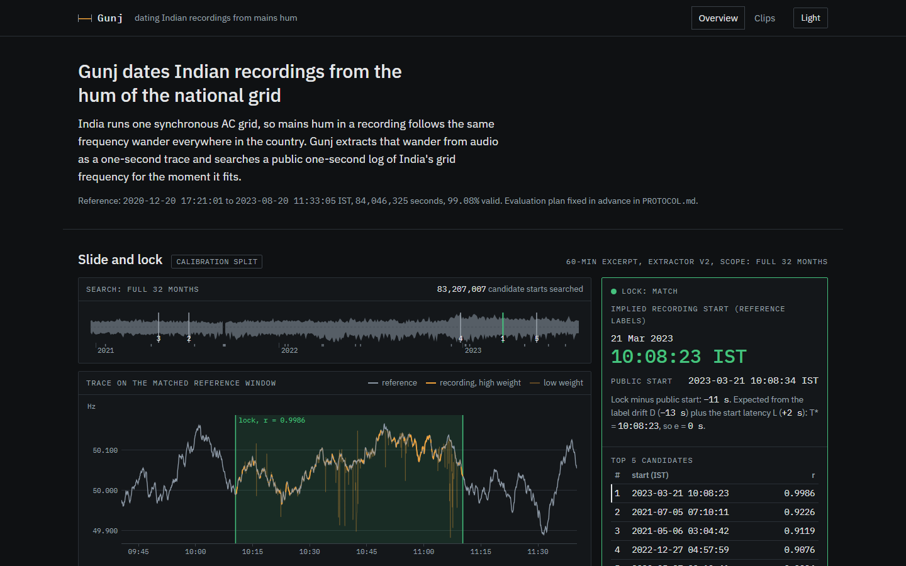

The example under the summary is a stream of the Calibration split, which was used to set the start latency L, so its lock is not a blind Test result.

> [!IMPORTANT]
> **What Gunj does**
> - Reports when a recording started, in IST at one-second resolution on the reference's own time labels, if the recording carries mains hum and was made inside the reference period (<!-- span:start -->20 Dec 2020 to 20 Aug 2023<!-- span:end -->). In the blind test, <!-- does-accuracy:start -->14 of the 23 confident verdicts on 60-min excerpts were within 30 s of the expected start and 9 were further off<!-- does-accuracy:end --> (Results).
> - Lists the five best candidate start times with their correlations, and a confidence: the margin of the best candidate over the best one at least 60 s away.
> - Says "no verdict" when there is no hum, or when the confidence is below a threshold that was fixed on held-out negatives before any Test search.
>
> **What Gunj does not do**
> - It does not locate a recording. India runs one synchronous grid, so the hum's frequency is the same across the country at any moment. Gunj reports time and grid only.
> - It cannot date a recording made after the reference ends (<!-- span-end:start -->20 Aug 2023<!-- span-end:end -->) or on another country's grid.
> - It does not prove that a recording is genuine. A match is evidence of when the hum was recorded. A missing hum is evidence of nothing. Someone with the grid log could add a matching hum.
> - It does not give certain verdicts. The blind test below has confident verdicts that are wrong and a false match on a foreign recording.
> - It does not publish audio. The repo keeps only video IDs, file hashes and derived 1-Hz traces, and downloaded audio is deleted after extraction (Ethics lists the one exception).

## Results

Every number in this section is written by `scripts/fill_results.py` from the file named beside it. Re-run it after `scripts/evaluate.py`, `scripts/m5_edits.py` and `scripts/make_figures.py`, and the numbers update.

Terms used below. T* is the expected start of a recording on the reference's own time labels: YouTube's release time plus the latency L plus the stream's label-drift correction D (Method). A hit is a top candidate within 30 s of T*. A confident verdict, or "match", needs the hum flag and a confidence at or above the threshold tau of its cell. The primary cell is extractor v2 with 60-min excerpts searched over the full span.

<!-- status:start -->
- Gate (PROTOCOL section 15, decision time 8 Nov 2026 14:00 IST): **not met**, frozen 8 Nov 2026, 17:04 IST (`results/gate_frozen.json`).
- Test numbers are from `results/evaluation.json` and `results/test_results.csv`, last written by `scripts/evaluate.py` at 11 Nov 2026, 19:16 IST: 126 of 150 selected streams have a trace. That run took 126 Test streams from the search cache and searched none of them again, and it searched 24 negative streams (`timing` in the same file). No further download is planned (PROTOCOL section 19), so these numbers are final.
- M5 (on SYNTHETIC cuts), the confident-verdict breakdown, M4 at the measured noise level and the figures were computed after the Test results were known, by `scripts/m5_edits.py` (run of 11 Nov 2026, 18:59 IST) and `scripts/make_figures.py`. They read the scoring outputs and change none of them. Anything PROTOCOL.md did not pre-register is labelled EXPLORATORY (post hoc).
- The reference, label-drift, latency, threshold, Dev and uniqueness results were measured before any Test search and do not change.
<!-- status:end -->

<!-- results:start -->
### Gate (PROTOCOL section 15)

- **Gate not met** (frozen 8 Nov 2026, 17:04 IST, `results/gate_frozen.json`).
- Conditions 1 and 2: 38 of N = 126 Test streams harvested by the decision time locked blind (5 needed): extractor v2, top candidate in the full span or ±90 days within 30 s of T* for at least one excerpt length, with confidence at or above tau of that cell. Met.
- The same count without the label-drift correction (S1, D = 0): 9.
- Condition 3, harvest health: not met. YouTube answered 1 stream (vMIFXzQiZMA) with a bot check on 8 Nov 2026, 05:30 IST, and the harvester stopped as PROTOCOL section 17 requires. tau and L committed by the decision time: yes.
- Locks with the baselines on the same streams (description only): v1 19; naive 13.
- PROTOCOL section 15 says to switch projects when the gate is not met. Shrey decided to stay with Gunj; PROTOCOL section 19 (8 Nov 2026) and Deviations below give the reasons.
- `results/gate.md` lists every processed stream, hits and misses.

### Test split, pre-registered and blind

| result | value | source |
|---|---|---|
| M1 hum present (extractor v1, all downloaded audio; Test streams with audio) | 50/126 (39.7%, 95% CI 31.6 to 48.4%) | `results/test_results.csv` |
| M2 primary endpoint: top-1 start within 30 s of T*, v2, 60-min excerpts, full span | 25/90 (27.8%, 95% CI 19.6 to 37.8%) | `results/evaluation.json` |
| Same cell: confident hit (hum flag set and confidence at or above tau, within 30 s) | 14/90 (15.6%, 95% CI 9.5 to 24.4%) | `results/evaluation.json` |
| Same cell: confident wrong (verdict match, more than 30 s off) | 9/90 (10.0%, 95% CI 5.4 to 17.9%) | `results/evaluation.json` |
| Same cell: no verdict | 67/90 (74.4%, 95% CI 64.6 to 82.3%) | `results/evaluation.json` |
| Same cell, M1 hum-present streams only: top-1 within 30 s | 16/37 (43.2%, 95% CI 28.7 to 59.1%) | `results/evaluation.json` |
| v2, 60 min, ±90 days: top-1 within 30 s | 25/90 (27.8%, 95% CI 19.6 to 37.8%) | `results/evaluation.json` |
| M3 false matches at tau, report-half negatives, v2, 60 min, full span: real foreign 50 Hz streams | 1/16 (6.2%, 95% CI 1.1 to 28.3%) | `results/evaluation.json` (`m3`; also `results/false_matches.md`) |
| M3 false matches at tau, report-half negatives, v2, 60 min, full span: SYNTHETIC noise and hum | 0/20 (0.0%, 95% CI 0.0 to 16.1%) | `results/evaluation.json` (`m3`; also `results/false_matches.md`) |
| M3 false matches at tau, report-half negatives, v2, 60 min, full span: real and SYNTHETIC together | 1/36 (2.8%, 95% CI 0.5 to 14.2%) | `results/evaluation.json` (`m3`; also `results/false_matches.md`) |
| M5 edit detection on SYNTHETIC cuts of 10 to 120 s: detected within 30 s of the true position | 14/28 (50.0%, 95% CI 32.6 to 67.4%) | `results/m5.json` |
| M5 false alarms (the cuts are SYNTHETIC): uncut excerpts of the same streams with an edit reported | 2/14 (14.3%, 95% CI 4.0 to 39.9%) | `results/m5.json` |
| M6 live station (optional) | not run | PROTOCOL section 11 |

M3 used 24 of 25 real and 20 of 20 SYNTHETIC report-half negatives (`results/evaluation.json`, `m3_counts`). Every cell is in the M3 subsection below.

### M2 top-1 within 30 s, extractor v2 (Wilson 95%; `results/evaluation.json`)

| excerpt | full span | ±90 days | ±1 day |
|---|---|---|---|
| 10 min | 28/126 (22.2%, 95% CI 15.8 to 30.2%) | 28/126 (22.2%, 95% CI 15.8 to 30.2%) | 35/126 (27.8%, 95% CI 20.7 to 36.2%) |
| 20 min | 31/126 (24.6%, 95% CI 17.9 to 32.8%) | 31/126 (24.6%, 95% CI 17.9 to 32.8%) | 40/126 (31.7%, 95% CI 24.3 to 40.3%) |
| 40 min | 26/104 (25.0%, 95% CI 17.7 to 34.1%) | 26/104 (25.0%, 95% CI 17.7 to 34.1%) | 30/104 (28.8%, 95% CI 21.0 to 38.2%) |
| 60 min | 25/90 (27.8%, 95% CI 19.6 to 37.8%) | 25/90 (27.8%, 95% CI 19.6 to 37.8%) | 28/90 (31.1%, 95% CI 22.5 to 41.3%) |

Confident wrong (verdict match, more than 30 s off), same cells:

| excerpt | full span | ±90 days | ±1 day |
|---|---|---|---|
| 10 min | 2/126 (1.6%, 95% CI 0.4 to 5.6%) | 2/126 (1.6%, 95% CI 0.4 to 5.6%) | 2/126 (1.6%, 95% CI 0.4 to 5.6%) |
| 20 min | 2/126 (1.6%, 95% CI 0.4 to 5.6%) | 2/126 (1.6%, 95% CI 0.4 to 5.6%) | 2/126 (1.6%, 95% CI 0.4 to 5.6%) |
| 40 min | 8/104 (7.7%, 95% CI 3.9 to 14.4%) | 9/104 (8.7%, 95% CI 4.6 to 15.6%) | 7/104 (6.7%, 95% CI 3.3 to 13.2%) |
| 60 min | 9/90 (10.0%, 95% CI 5.4 to 17.9%) | 8/90 (8.9%, 95% CI 4.6 to 16.6%) | 7/90 (7.8%, 95% CI 3.8 to 15.2%) |

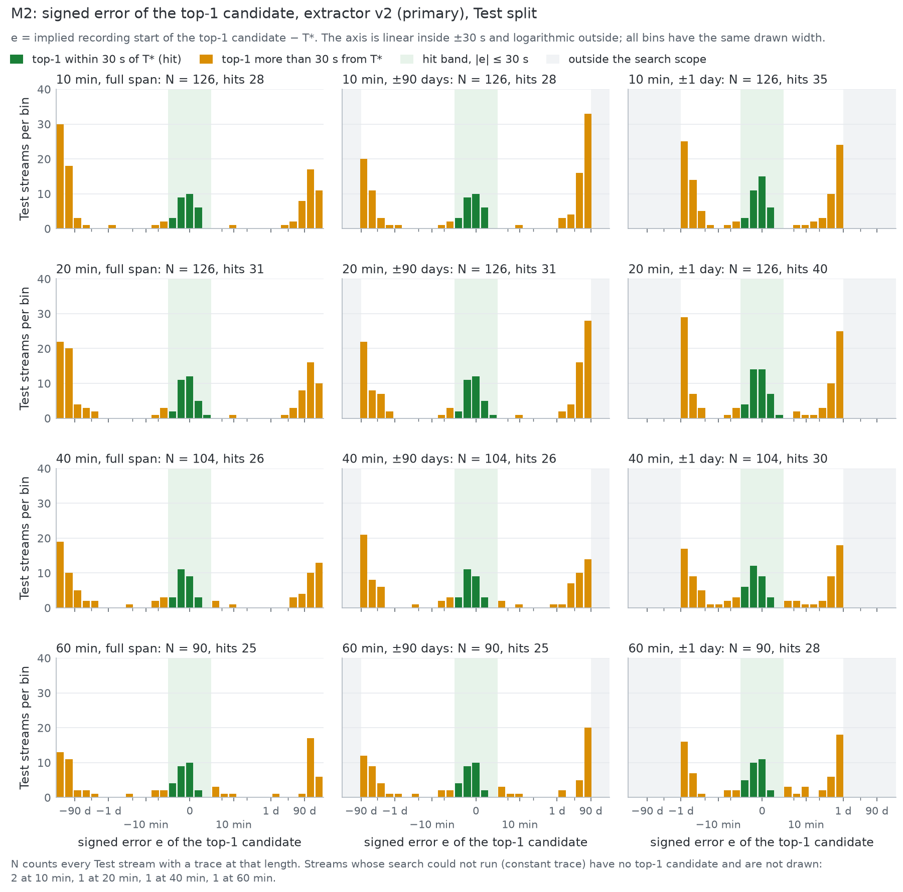

Figure: look at the bottom-left panel, the primary cell (60 min, full span): the green bars inside the ±30 s band are its 25 hits, and 54 of the other top candidates are more than a day from T* (`results/test_results.csv`, `error_s`).

<details>
<summary>The same plot for the two baseline extractors</summary>

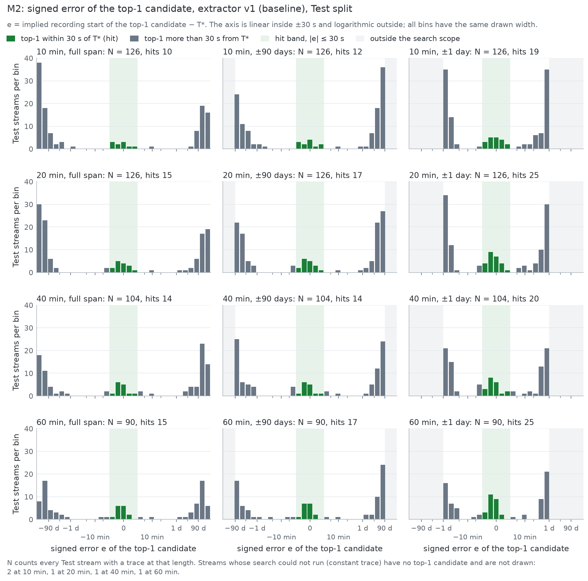

Figure: look at the same bottom-left panel for the frozen extractor v1: 15 of 90 top candidates fall in the green ±30 s band.

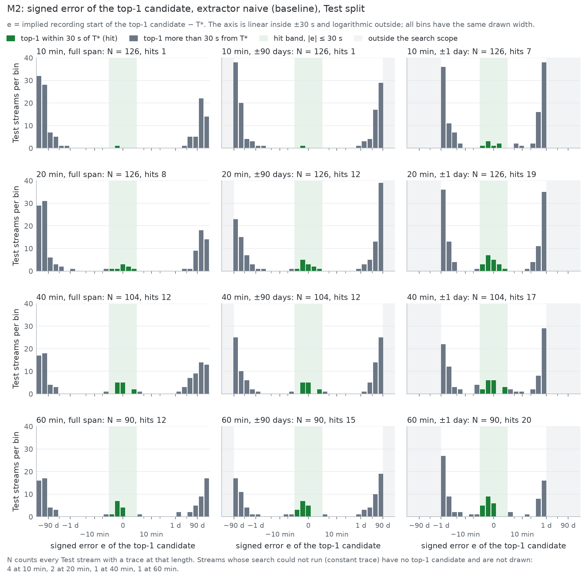

Figure: look at the same bottom-left panel for the naive single-bin 50 Hz extractor: 12 of 90 top candidates fall in the green ±30 s band.

</details>

### How far off the top candidate is (coarse hits, PROTOCOL section 9)

A hit is a top candidate within 30 s of T*, and nothing wider is ever counted as a hit. PROTOCOL section 9 also pre-registered two coarser distances, 120 s and 600 s, to describe the label problem. The table splits the primary cell (v2, 60 min, full span) by them. Source: `results/error_breakdown.json`, written by `scripts/make_figures.py` from `results/test_results.csv`; this script recounts every cell from the CSV before it copies a number.

| excerpts | n | within 30 s (hit) | 30 to 120 s | 120 to 600 s | beyond 600 s | no candidate |
|---|---|---|---|---|---|---|
| verdict "match" (confident) | 23 | 14 | 6 | 1 | 2 | 0 |
| all, whatever the verdict | 90 | 25 | 7 | 2 | 55 | 1 |

- Confident verdicts, counted with the coarse columns: 14 within 30 s, 20 within 120 s and 21 within 600 s of the 23. PROTOCOL section 11 defines no rate over confident verdicts, so no share or interval is given for them.
- The 2 confident verdicts beyond 600 s are off by 5,299 s (88 minutes, stream juw1pt_s2lM) and 2,876,519 s (33.3 days, stream HDfWJP4QYo0) (`results/test_results.csv`, `error_s`).
- Every confident verdict more than 30 s from T* counts as confident wrong, whatever its class: 9 of the 23.
- All top candidates, cumulative: within 30 s 25/90 (27.8%, 95% CI 19.6 to 37.8%); within 120 s 32/90 (35.6%, 95% CI 26.4 to 45.8%); within 600 s 34/90 (37.8%, 95% CI 28.5 to 48.1%). "No candidate" means the search could not run (a constant trace); such an excerpt stays in the denominator.

Confident verdicts by excerpt length over the full span. tau differs by cell (PROTOCOL section 10), so a longer excerpt is also judged against another threshold.

| excerpt | tau | confident verdicts | within 30 s | 30 to 120 s | 120 to 600 s | beyond 600 s |
|---|---|---|---|---|---|---|
| 10 min | 0.1645 | 19 | 17 | 1 | 1 | 0 |
| 20 min | 0.2233 | 21 | 19 | 1 | 1 | 0 |
| 40 min | 0.0622 | 24 | 16 | 6 | 1 | 1 |
| 60 min | 0.0834 | 23 | 14 | 6 | 1 | 2 |

Every cell of every extractor is in `results/error_breakdown.md`.

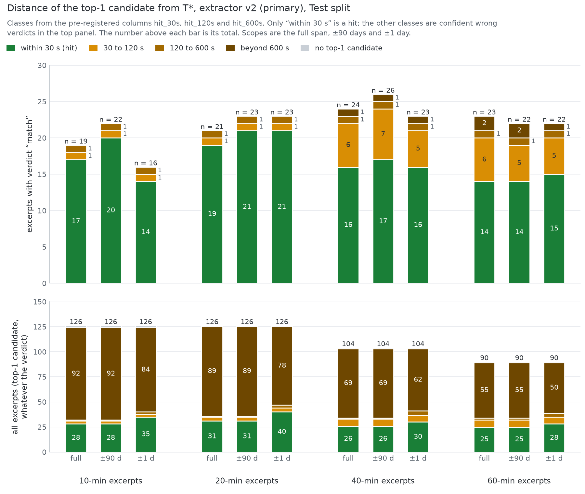

Figure: look at the 60-min, full-span bar of the top panel: of its 23 confident verdicts 14 are green (within 30 s), 6 are 30 to 120 s off, 1 is 120 to 600 s off and 2 are beyond 600 s.

### Baselines on the same streams, 60 min, full span

| method | top-1 within 30 s | confident hit | confident wrong | paired with v2 on the same streams (both hit / v2 only / baseline only / neither) |
|---|---|---|---|---|
| v2 (primary) | 25/90 (27.8%, 95% CI 19.6 to 37.8%) | 14/90 (15.6%, 95% CI 9.5 to 24.4%) | 9/90 (10.0%, 95% CI 5.4 to 17.9%) |  |
| v1 (frozen extractor) | 15/90 (16.7%, 95% CI 10.4 to 25.7%) | 11/90 (12.2%, 95% CI 7.0 to 20.6%) | 4/90 (4.4%, 95% CI 1.7 to 10.9%) | 15 / 10 / 0 / 65 (n = 90) |
| naive single-bin 50 Hz | 12/90 (13.3%, 95% CI 7.8 to 21.9%) | 8/90 (8.9%, 95% CI 4.6 to 16.6%) | 2/90 (2.2%, 95% CI 0.6 to 7.7%) | 12 / 13 / 0 / 65 (n = 90) |
| libhum | not run: libhum was never installed, and the time went to the harvest problems (PROTOCOL section 19, 11 Nov 2026) | | | |
| random guess (analytic) | p = 7.258 × 10^-7 per stream; expected chance hits over these 90 streams: 6.5 × 10^-5 | | | |

Sources: `results/evaluation.json` (rates), `results/test_results.csv` (pairs), `results/splits_summary.json` (random guess). No significance test is run (PROTOCOL section 13).

### Sensitivity analyses (PROTOCOL section 13), v2, 60 min, full span

| analysis | top-1 within 30 s | source |
|---|---|---|
| as pre-registered (T* = release time + L + D) | 25/90 (27.8%, 95% CI 19.6 to 37.8%) | `results/evaluation.json` |
| S1: no label-drift correction (D = 0) | 5/90 (5.6%, 95% CI 2.4 to 12.4%) | `results/evaluation.json` |
| S2: label-stable streams only | 9/25 (36.0%, 95% CI 20.2 to 55.5%) | `results/test_results.csv`, `label_stable` |
| S3: verified channels only | 22/75 (29.3%, 95% CI 20.2 to 40.4%) | `results/test_results.csv`, `channel_status` |
| S4: v1 against v2 | see the paired column above | `results/test_results.csv` |

### M1 hum presence by venue type (`results/test_results.csv`)

| venue type | hum present |
|---|---|
| conference | 0/1 (0.0%, 95% CI 0.0 to 79.3%) |
| government event | 6/25 (24.0%, 95% CI 11.5 to 43.4%) |
| lecture | 5/29 (17.2%, 95% CI 7.6 to 34.5%) |
| legislature | 28/52 (53.8%, 95% CI 40.5 to 66.7%) |
| religious | 11/19 (57.9%, 95% CI 36.3 to 76.9%) |
| all | 50/126 (39.7%, 95% CI 31.6 to 48.4%) |

M1 for the real foreign 50 Hz negatives, as description only (PROTOCOL section 11): the v1 hum flag is set for 19/47 (40.4%, 95% CI 27.6 to 54.7%) harvested streams, 10/23 in the threshold half and 9/24 in the report half (`data/harvest_manifest.csv`, column `hum_present_v1`; halves from `data/splits.csv`).

### M3: false matches on the report-half negatives (PROTOCOL section 11)

A false match is a report-half negative excerpt whose confidence reaches tau for its cell. 24 of the 25 real foreign 50 Hz streams and 20 of the 20 SYNTHETIC items were searched (`results/evaluation.json`, `m3_counts`). A negative has an excerpt in a cell only if its stream is long enough. tau was set on the threshold half, which shares no stream with the report half. Extractor v2, Wilson 95% (`results/evaluation.json`, `m3`):

| excerpt | scope | tau | real foreign 50 Hz streams | SYNTHETIC noise and hum | real and SYNTHETIC together |
|---|---|---|---|---|---|
| 10 min | full span | 0.1645 | 1/24 (4.2%, 95% CI 0.7 to 20.2%) | 0/20 (0.0%, 95% CI 0.0 to 16.1%) | 1/44 (2.3%, 95% CI 0.4 to 11.8%) |
| 10 min | ±90 days | 0.1645 | 1/24 (4.2%, 95% CI 0.7 to 20.2%) | 0/20 (0.0%, 95% CI 0.0 to 16.1%) | 1/44 (2.3%, 95% CI 0.4 to 11.8%) |
| 10 min | ±1 day | 0.4292 | 0/24 (0.0%, 95% CI 0.0 to 13.8%) | 0/20 (0.0%, 95% CI 0.0 to 16.1%) | 0/44 (0.0%, 95% CI 0.0 to 8.0%) |
| 20 min | full span | 0.2233 | 0/24 (0.0%, 95% CI 0.0 to 13.8%) | 0/20 (0.0%, 95% CI 0.0 to 16.1%) | 0/44 (0.0%, 95% CI 0.0 to 8.0%) |
| 20 min | ±90 days | 0.2233 | 0/24 (0.0%, 95% CI 0.0 to 13.8%) | 0/20 (0.0%, 95% CI 0.0 to 16.1%) | 0/44 (0.0%, 95% CI 0.0 to 8.0%) |
| 20 min | ±1 day | 0.3279 | 0/24 (0.0%, 95% CI 0.0 to 13.8%) | 0/20 (0.0%, 95% CI 0.0 to 16.1%) | 0/44 (0.0%, 95% CI 0.0 to 8.0%) |
| 40 min | full span | 0.0622 | 1/18 (5.6%, 95% CI 1.0 to 25.8%) | 2/20 (10.0%, 95% CI 2.8 to 30.1%) | 3/38 (7.9%, 95% CI 2.7 to 20.8%) |
| 40 min | ±90 days | 0.0637 | 0/18 (0.0%, 95% CI 0.0 to 17.6%) | 1/20 (5.0%, 95% CI 0.9 to 23.6%) | 1/38 (2.6%, 95% CI 0.5 to 13.5%) |
| 40 min | ±1 day | 0.3763 | 0/18 (0.0%, 95% CI 0.0 to 17.6%) | 0/20 (0.0%, 95% CI 0.0 to 16.1%) | 0/38 (0.0%, 95% CI 0.0 to 9.2%) |
| 60 min | full span | 0.0834 | 1/16 (6.2%, 95% CI 1.1 to 28.3%) | 0/20 (0.0%, 95% CI 0.0 to 16.1%) | 1/36 (2.8%, 95% CI 0.5 to 14.2%) |
| 60 min | ±90 days | 0.1412 | 0/16 (0.0%, 95% CI 0.0 to 19.4%) | 0/20 (0.0%, 95% CI 0.0 to 16.1%) | 0/36 (0.0%, 95% CI 0.0 to 9.6%) |
| 60 min | ±1 day | 0.2334 | 0/16 (0.0%, 95% CI 0.0 to 19.4%) | 1/20 (5.0%, 95% CI 0.9 to 23.6%) | 1/36 (2.8%, 95% CI 0.5 to 14.2%) |

- Target: at most 1% (PROTOCOL section 11). In the primary cell it is not met: 1/16 (6.2%, 95% CI 1.1 to 28.3%) real negatives at or above tau. No cell has enough negatives to show a rate below 1%: the smallest Wilson upper bound, real and SYNTHETIC together, is 8.0%.
- Real negatives at or above tau in some v2 cell: zRAR5_1lvIc (10 min full span, 10 min ±90 days); 1d-v89-whQE (40 min full span); HNBb4ltVQug (60 min full span).
- SYNTHETIC negatives at or above tau in some v2 cell: SYN-WALK-16 (40 min full span, 40 min ±90 days); SYN-WALK-08 (40 min full span); SYN-WALK-20 (60 min ±1 day).
- With the hum-flag condition added, the v2 counts are the same in every cell. v1 and the naive extractor are in `results/false_matches.md`.

Reliability of the confidence score in the primary cell: Test top-1 hit rate by the pre-registered confidence bins (`results/figures/figures.json`, written by `scripts/make_figures.py`).

| confidence bin | Test excerpts | top-1 within 30 s |
|---|---|---|
| [0, 0.025) | 46 | 0/46 (0.0%, 95% CI 0.0 to 7.7%) |
| [0.025, 0.05) | 9 | 1/9 (11.1%, 95% CI 2.0 to 43.5%) |
| [0.05, 0.1) | 4 | 2/4 (50.0%, 95% CI 15.0 to 85.0%) |
| [0.1, 0.2) | 8 | 7/8 (87.5%, 95% CI 52.9 to 97.8%) |
| [0.2, 0.4) | 4 | 3/4 (75.0%, 95% CI 30.1 to 95.4%) |
| [0.4, inf) | 18 | 12/18 (66.7%, 95% CI 43.7 to 83.7%) |

1 of the 90 excerpts has no confidence because the search could not run. In this cell the largest confidence of a real negative is 0.1339 and of a SYNTHETIC negative 0.0394; tau is 0.0834.

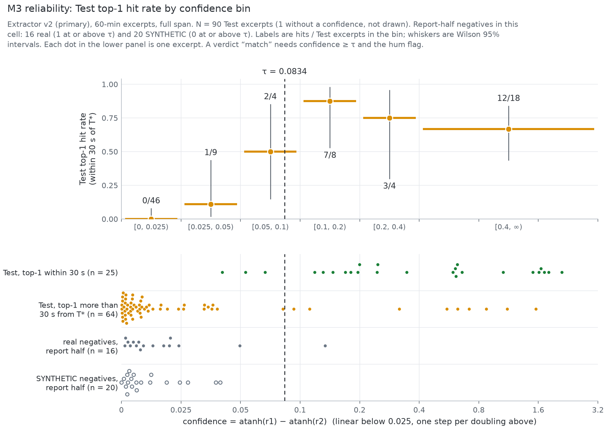

Figure: look at the dashed line at tau: Test excerpts with confidence below 0.025 hit in 0 of 46 cases, those at 0.1 or above hit in 22 of 30, and 1 of the 16 real negatives (filled grey dots) lies to the right of it.

<details>
<summary>The reliability plot for all 12 cells of v2</summary>

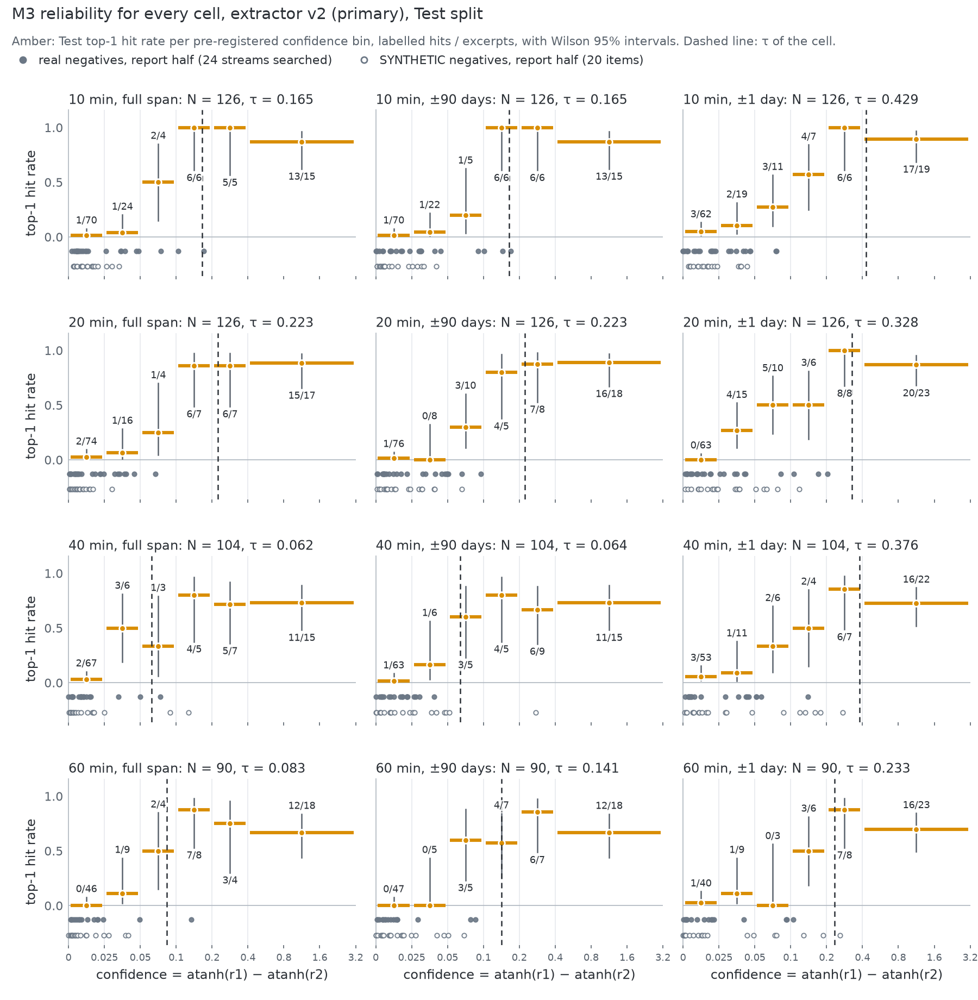

Figure: look at the grey dots under each panel against the dashed tau line: a real negative (filled) reaches tau in 4 of the 12 cells and a SYNTHETIC negative (open) in 3.

</details>

### M5: edit detection on SYNTHETIC cuts (PROTOCOL section 11)

Every cut is SYNTHETIC. At harvest time a stretch of 10 to 120 s was removed from the 60-min excerpt audio, the cut audio was extracted with v2, and the audio was deleted. No recording with a real edit was tested. M5 uses the 14 Test streams whose uncut 60-min excerpt is a confident hit over the full span, 2 SYNTHETIC cuts each. Each SYNTHETIC cut trace is located in the ±1-day scope and passed to `find_edits` with its frozen defaults. A detection is a reported cut within 30 s of the true position of the SYNTHETIC cut. Source: `results/m5.json`, written by `scripts/m5_edits.py` at 11 Nov 2026, 18:59 IST.

| SYNTHETIC cut length | SYNTHETIC cuts | detected | duration error of the detected SYNTHETIC cuts, median / max |
|---|---|---|---|
| SYNTHETIC, 10 s | 3 | 0/3 (0.0%, 95% CI 0.0 to 56.1%) | n/a (none detected) |
| SYNTHETIC, 20 s | 5 | 2/5 (40.0%, 95% CI 11.8 to 76.9%) | 0.5 s / 1 s |
| SYNTHETIC, 40 s | 6 | 3/6 (50.0%, 95% CI 18.8 to 81.2%) | 2 s / 4 s |
| SYNTHETIC, 60 s | 5 | 3/5 (60.0%, 95% CI 23.1 to 88.2%) | 1 s / 3 s |
| SYNTHETIC, 90 s | 1 | 1/1 (100.0%, 95% CI 20.7 to 100.0%) | 2 s / 2 s |
| SYNTHETIC, 120 s | 8 | 5/8 (62.5%, 95% CI 30.6 to 86.3%) | 2 s / 5 s |
| all SYNTHETIC cuts | 28 | 14/28 (50.0%, 95% CI 32.6 to 67.4%) | 1.5 s / 5 s |

- False alarms (SYNTHETIC test): `find_edits` reported an edit on 2/14 (14.3%, 95% CI 4.0 to 39.9%) of the uncut excerpts of the same streams, 2 edits in all.
- Every SYNTHETIC cut with its reported position and jump, and the readings chosen where PROTOCOL section 11 leaves room, are in `results/m5.md`.

### Flow, Test streams (`results/evaluation.json`; drop reasons in `results/flow_table.md`)

| step | streams |
|---|---|
| selected | 150 |
| download attempted | 145 |
| audio obtained | 126 |
| trace extracted (v2) and searched | 126 |
| hum present (M1) | 50 |
| match (v2, any length, full or ±90 days), of the 50 hum-present streams | 30 |
| hit (confident hit), of the 50 hum-present streams | 25 |

- The flow follows the 50 streams with the M1 hum flag on all their audio. A verdict uses the hum flag of the excerpt's own trace, so 6 more streams got the verdict "match" although the M1 flag is off, 5 of them with a confident hit (`results/flow_table.md`).
- Over all 126 streams with a trace, 36 get the verdict "match" at some excerpt length (v2, full span or ±90 days) and 30 have a confident hit. The gate's 38 locks need a top candidate within 30 s and confidence at or above tau, but not the hum flag, so 8 of them get no verdict at the excerpts that lock. None of these stream counts is the primary endpoint, which counts the 60-min excerpts over the full span (25 of 90).

### Measured before any Test search

- **Reference** (`results/reference_stats.json`): 2020-12-20 17:21:01 to 2023-08-20 11:33:05 IST, 84,046,325 seconds (972.76 days), 83,273,631 valid (99.08%). 61 gaps longer than 10 s hold 772,056 missing seconds; the longest runs from 2021-09-11 13:22:38 to 2021-09-16 10:10:15 (420,458 s).
- **The reference's time labels drift** (`results/time_axis_check.json`). Checked against the grid's 15-minute scheduling clock, each file's labels run late by the end of the file: I 172 s, II 64 s, III 319 s, IV 198 s, V 224 s. Where two files overlap they label the same values 172 s, 64 s, 319 s, 198 s apart (I-II, II-III, III-IV, IV-V), and the clock check gives the same four offsets within 1 s. Gunj therefore corrects every stream by its own drift estimate D. For 93 of the 150 Test streams |D| is over 30 s, more than the ±30 s hit tolerance itself (median |D| 58 s, largest 319 s; `results/splits_summary.json`). 39 Test streams are label-stable (S2).
- **Latency L** (`results/latency.json`, Calibration split only): L = 2 s (calibrated), the median offset o of the 5 Calibration streams of 19 harvested (20 selected) that locked with confidence at or above tau and |o| ≤ 600 s. Their o runs from -4 s to 5 s (IQR 0 s to 2 s). The range is within the 60 s that PROTOCOL section 6 allows for one constant latency. Streams that count, by extractor (`results/calibration.json`): v2 5, v1 2, naive 1 of 19.
- **Hum on the Calibration split** (description only, `results/calibration.json`): v1 hum flag on 7/19 (36.8%, 95% CI 19.1 to 59.0%) harvested streams.
- **Threshold tau** (`results/threshold.json`): set per extractor, excerpt length and scope on the threshold half of the negatives, 23 real foreign 50 Hz streams and 20 SYNTHETIC items (2 real ones could not be downloaded). v2, 60 min: full span 0.0834, ±90 days 0.1412, ±1 day 0.2334.
  - The highest raw correlation of any real negative was r1 = 0.9951 (v2, 10 min, full span), but its confidence was only 0.0022 because its runner-up scored almost as high. Foreign recordings can correlate strongly with some stretch of the Indian log, which is why the confidence is the margin atanh(r1) - atanh(r2) over the best candidate at least 60 s away.
- **Extractor v2, tuned on the 5 Dev streams only** (`results/v2_tuning.json`; Dev is never pooled with Test): objective J = 0.222 for the chosen candidate B1, against -0.012 for v1 and -0.046 for the naive extractor.

### M4: how much audio a unique lock needs (reference only, SYNTHETIC noise)

Excerpts of the real reference, with SYNTHETIC noise added and no audio, searched like a recording. The table below was read before any Test search, at 40 mHz, the tested level nearest the 5 Nov probe's median equivalent trace noise of 38.6 mHz (`results/probe_noise.json`). `white` is independent each second; `hann16` is smoothed over 16 s like real extractor error, so it is the closer stand-in. Source: `results/uniqueness_table.csv`; all levels are plotted in `results/uniqueness_curve.png`.

| scope | SYNTHETIC noise | shortest tested length with at least 90% unique locks | hit rate there | hits at 5, 10, 20, 40 and 60 min |
|---|---|---|---|---|
| full span | white | 20 min | 450/450 (100.0%, 95% CI 99.2 to 100.0%) | 5, 305, 450, 450, 450 of 450 |
| full span | hann16 | 40 min | 422/450 (93.8%, 95% CI 91.2 to 95.7%) | 0, 1, 121, 422, 450 of 450 |
| ±90 days | white | 20 min | 800/800 (100.0%, 95% CI 99.5 to 100.0%) | 33, 638, 800, 800, 800 of 800 |
| ±90 days | hann16 | 40 min | 776/800 (97.0%, 95% CI 95.6 to 98.0%) | 0, 6, 325, 776, 799 of 800 |
| ±1 day | white | 10 min | 1934/2000 (96.7%, 95% CI 95.8 to 97.4%) | 759, 1934, 2000, 2000, 2000 of 2000 |
| ±1 day | hann16 | 40 min | 1986/2000 (99.3%, 95% CI 98.8 to 99.6%) | 12, 362, 1627, 1986, 1999 of 2000 |

**M4 at the measured noise level.** PROTOCOL section 11 reads the curve at the equivalent trace noise of the Test streams that lock, "computed as in `scripts/probe_noise.py`". That script turns the plain (unweighted) Pearson r of a trace with the reference window it matched, and the plain standard deviation s of that window, into sigma = s · sqrt(1/r² − 1). Reading B applies the same computation to the 38 streams the gate counts as locks (88 locking excerpts, one median per stream), so it is the pre-registered reading. Reading A puts v2's weighted correlation, as scored, into the same formula; it was added after the Test results were known and is EXPLORATORY (post hoc). Source: `results/m4_measured.json` (`scripts/make_figures.py`); SYNTHETIC `hann16` noise, rates interpolated linearly between the tested noise levels.

| reading | median noise over streams (Q1 to Q3) | full span | ±90 days | ±1 day |
|---|---|---|---|---|
| B, pre-registered: unweighted r, as in `scripts/probe_noise.py` | 37.4 mHz (12.9 to 71.2) | 40 min (94.6%) | 40 min (97.4%) | 40 min (99.4%) |
| A, EXPLORATORY (post hoc): r as scored (v2's weighted correlation) | 9.4 mHz (4.1 to 16.8) | 10 min (91.2%) | 10 min (96.1%) | 10 min (99.6%) |

Each entry is the shortest tested length (5, 10, 20, 40, 60 min) whose interpolated share of unique locks is at least 90%, with that share; the length needed lies between the tested length before it and the one shown. The readings at the quartiles, and the EXPLORATORY (post hoc) readings for other definitions of "streams that lock", are in `results/m4_measured.md`.

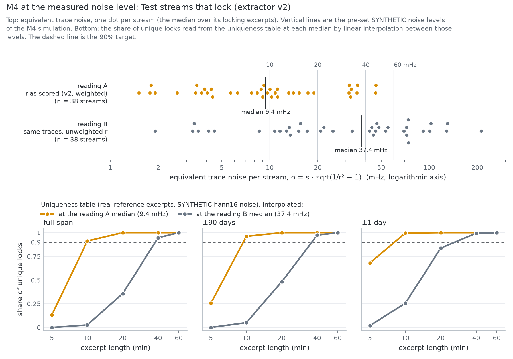

Figure: look at the reading B median in the top panel, 37.4 mHz (pre-registered): in the bottom-left panel (full span) its curve first reaches the 90% line at 40 min. The EXPLORATORY (post hoc) reading A (9.4 mHz, r as scored) reaches it at 10 min.

### EXPLORATORY (post hoc) analyses

Nothing in this subsection is in PROTOCOL.md. Both analyses were run after the Test results were known. They describe the pre-registered results and change none of them.

- **EXPLORATORY (post hoc): the confident verdicts 30 to 600 s from T*** (`results/exploratory_offset_verdicts.md`). In the primary cell the 14 confident verdicts within 30 s have a median |D| of 60.5 s, and 6 of them are on label-stable streams. The 7 verdicts 30 to 600 s off have a median |D| of 67 s, and 2 are on label-stable streams. Over the full span, 10 streams have such an offset verdict at some excerpt length, and 5 of them have a top candidate within 30 s at another length. These are counts and medians, with no test and no new threshold. T* rests on YouTube's start time, L and D, so the table cannot say which of them an offset comes from.
- **EXPLORATORY (post hoc): M5 on every gate lock that has SYNTHETIC cut traces** (`results/m5.md`). Of the 38 gate locks, 31 have SYNTHETIC cut traces: the pre-registered streams and 17 more. Over all of them 16/62 (25.8%, 95% CI 16.6 to 37.9%) SYNTHETIC cuts were detected, and on the 17 additional streams alone 2/34 (5.9%, 95% CI 1.6 to 19.1%). The additional streams are gate locks through another excerpt length, the ±90-day scope, or a lock without the hum flag; over the full span the 60-min excerpt of 5 is "confident wrong" and of 12 is "no verdict". 8 of the 17 lock in the 60-min full-span cell itself and get no verdict there only because their trace has no hum flag.

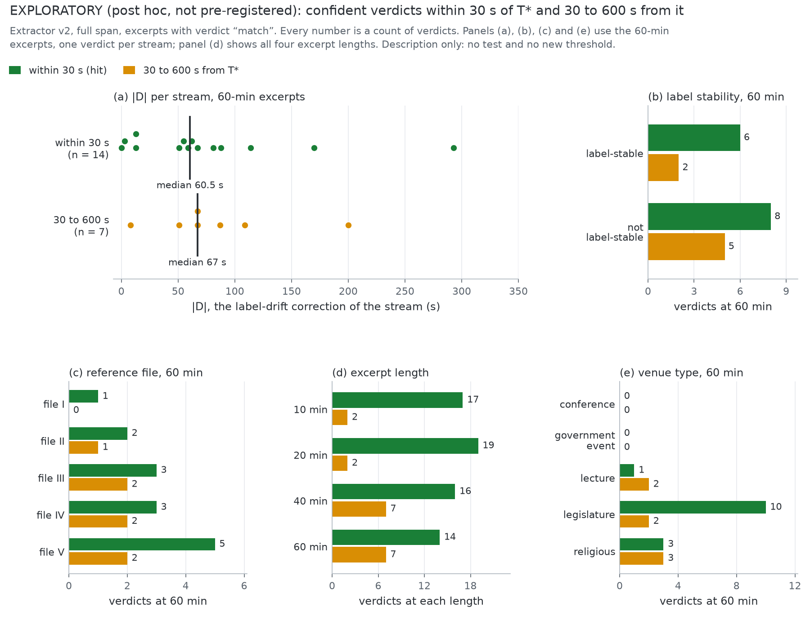

Figure: EXPLORATORY (post hoc): look at panel (a), where the drift corrections |D| of the 14 confident verdicts within 30 s (median 60.5 s, from 0 s to 293 s) and of the 7 verdicts 30 to 600 s off (median 67 s, from 8 s to 200 s) overlap.
<!-- results:end -->

Other plots: `results/reference_coverage.png` (reference coverage by month) and `results/uniqueness_curve.png` (M4 at every tested noise level). `results/figures/README.md` has a longer caption for each figure above, and `results/figures/figures.json` has every number they draw.

## How it works

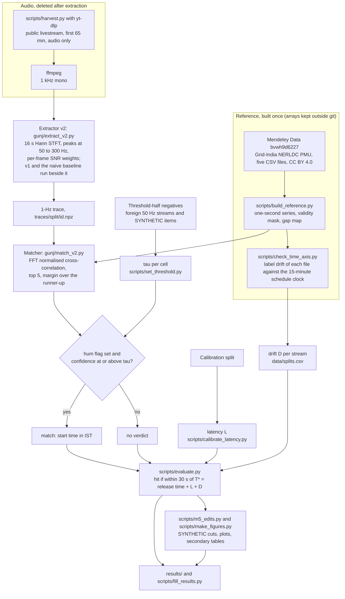

## Setup

Tested on Windows 11 with Python 3.12 only. There is no one-command setup: the reference has to be downloaded by hand from Mendeley Data and then built. Commands are for PowerShell, from the repo root.

**1. Install and test.**

```
python -m venv .venv
.venv\Scripts\python.exe -m pip install -e . pytest
$env:OPENBLAS_NUM_THREADS = "1"
.venv\Scripts\python.exe -m pytest
```

`pip install -e .` installs NumPy, SciPy, pandas, matplotlib and soundfile (`pyproject.toml`) and the `gunj` command. `OPENBLAS_NUM_THREADS=1` stops NumPy's OpenBLAS from reserving memory for every CPU thread; the scripts also set it themselves. Tests that need the built reference are skipped until it exists, and the harvester tests that need ffmpeg are skipped if it is not on PATH. yt-dlp is needed only to re-run the harvest (`pip install yt-dlp`). ffmpeg is needed for the harvest and for audio formats soundfile cannot read.

**2. Get and build the reference.** Download the five files `Frequency Data I.csv` to `Frequency Data V.csv` from https://data.mendeley.com/datasets/bvwh9d6227 into a folder `..\data\enf-ref` beside the repo folder, and rename them `freq_I.csv` to `freq_V.csv`. Check them against the SHA-256 values listed in `results/reference_summary.md` (`Get-FileHash ..\data\enf-ref\freq_I.csv -Algorithm SHA256`). Then:

```
.venv\Scripts\python.exe scripts\build_reference.py --ref-dir ..\data\enf-ref --derived-dir ..\data\derived
.venv\Scripts\python.exe scripts\check_time_axis.py --derived-dir ..\data\derived
```

The first command writes the one-second series, its validity mask and its source-file array to `..\data\derived` (outside git) and rewrites `results/reference_*`. The second writes `results/time_axis_check.json`, the label-drift check. `gunj` looks for the arrays in `..\data\derived`, or in the folder given by `--ref` or `$env:GUNJ_REF`.

**3. Date a recording.**

```
.venv\Scripts\gunj.exe date recording.flac
.venv\Scripts\gunj.exe date recording.flac --scope 1d --claimed 2023-03-21
.venv\Scripts\gunj.exe date recording.flac --excerpt-start 120 --excerpt-length 3600 --edits
.venv\Scripts\gunj.exe extract recording.flac --out trace.csv
```

`gunj date` prints JSON: the top five candidate start times in IST, their r, the margin and confidence, the hum statistics and a verdict. `--scope 1d --claimed DATE` checks a claimed date (the whole IST day, plus or minus one day). `--edits` looks for cuts relative to the best lock.

`gunj date` is a demonstration command and its verdicts are not the evaluated ones. It runs extractor v1 with the unweighted matcher, applies a single threshold (the largest v2 tau, <!-- cli-threshold:start -->0.4292<!-- cli-threshold:end -->, from `gunj/config.json`) and does not apply the latency L or the drift D. The evaluated pipeline (v2, one tau per cell, L and D) runs in `scripts/eval_common.py` and `scripts/evaluate.py`.

**4. Check and re-score the evaluation.** The 1-Hz traces (`traces/`), the raw search outputs (`results/search_cache/`) and the harvest manifest are in the repo, so the scoring can be re-run without any audio:

```
.venv\Scripts\python.exe scripts\make_splits.py --derived-dir ..\data\derived --verify-protocol PROTOCOL.md
.venv\Scripts\python.exe scripts\evaluate.py --workers 2
.venv\Scripts\python.exe scripts\m5_edits.py
.venv\Scripts\python.exe scripts\make_figures.py
.venv\Scripts\python.exe scripts\fill_results.py
```

- `make_splits.py --verify-protocol` re-draws the splits from the same inputs and seed and checks the SHA-256 values quoted in `PROTOCOL.md`.
- `evaluate.py` refuses to touch any Test trace unless `results/threshold.json`, `results/latency.json` and the code it runs are committed and unchanged. It re-searches only streams whose trace changed.
- `m5_edits.py` scores M5 on the SYNTHETIC cut traces and writes `results/m5.json` and `results/m5.md`. It needs the built reference, and it stops without writing if a trace or the matcher code differs from what the evaluation searched.
- `make_figures.py` writes the plots in `results/figures`, the confident-verdict breakdown (`results/error_breakdown.json` and `.md`), M4 at the measured noise level (`results/m4_measured.json` and `.md`) and the EXPLORATORY offset table. Only the M4 step needs the built reference; `--skip-m4-measure` reuses the existing `results/m4_measured.json`.
- `fill_results.py` rewrites the marked blocks in this README, in `video/NARRATION.md` and in `video/SCRIPT.md`. Before it copies a number from the later result files it recounts them against `results/test_results.csv`, and it stops if they disagree or if a spoken number in the narration differs from its source. `--check` writes nothing and exits 1 if a file is out of date.

The other scripts, in the order they ran: `harvest_metadata.py` (YouTube metadata only, no media), `make_splits.py`, `uniqueness.py` (M4, reference only), `harvest.py` through `run_stage3.ps1` (audio download, extraction, deletion), `tune_v2.py` (needs the Dev audio, which is not published, so it cannot be re-run from the repo), `set_threshold.py`, `calibrate_latency.py`, `evaluate.py`, `m5_edits.py`, `make_figures.py`, `export_site_data.py` (the explorer's data files in `site/data`), and `build_report.py` (the PDF report `docs/gunj-report.pdf` from `docs/report/template.html`; it fills every number from the result files and prints the PDF with Playwright). Checks and one-offs: `bench_search.py`, `cli_smoke_real_ref.py`, `synthetic_checks.py` (all SYNTHETIC), `probe_noise.py`, `mem_import_check.py`, `repair_outage_attempts.py`. Re-running the harvest downloads audio from YouTube, whose terms restrict downloading; those scripts are published so the method can be read and checked.

## Method

The full pre-registered plan is in [PROTOCOL.md](PROTOCOL.md). It was approved and committed on 7 Nov 2026 at 09:05 IST, before any Test or negative audio existed (commit 2485706). In short:

- **Question.** How often does Indian online media carry a datable grid fingerprint, and how much audio does dating it take?
- **Data.** Public YouTube livestreams of Indian legislatures, lectures, government events, religious venues and conferences, drawn from metadata only with <!-- splits:start -->seed 2026110701 into Dev (5), Calibration (20) and Test (150) splits, plus 50 foreign 50 Hz streams and 40 SYNTHETIC items<!-- splits:end --> as negatives (PROTOCOL section 5). No two Test streams overlap in time.
- **Excerpts and scopes.** From the first 65 min of each stream, excerpts of 10, 20, 40 and 60 min start 120 s in. Each is searched over the full reference, over ±90 days and over ±1 day around the stream's public start time (PROTOCOL section 8).
- **Extractor.** v1 (`gunj/extract.py`): 16 s Hann windows with a 1 s hop, peaks of harmonics 1 to 6 of 50 Hz refined by quadratic interpolation, harmonics weighted by their peak-to-floor ratio, a 5-point running median. v2 (`gunj/extract_v2.py`, `gunj/match_v2.py`) adds per-frame SNR weights to the trace and the correlation. v2 was tuned on the 5 Dev streams only and frozen (git tag `extractor-v2`) before any Calibration, Test or negative audio was extracted, so it is the primary extractor (PROTOCOL sections 7 and 19).
- **Matcher.** Normalised cross-correlation computed with FFTs over every position in the scope; windows with less than 90% valid reference seconds are skipped. Confidence = atanh(r1) - atanh(r2), where r2 is the best candidate at least 60 s from the top one.
- **Threshold.** One tau per extractor, excerpt length and scope, set on the threshold half of the negatives so that at most 1% of them reach it; with fewer than 100 negatives per cell, tau sits just above the largest negative confidence (PROTOCOL section 10). A verdict "match" needs the hum flag (any harmonic's median peak-to-floor ratio at least 3) and confidence at or above tau.
- **Ground truth.** T* = YouTube's release time in IST + L + D. L is one constant start latency, estimated on the Calibration split only. D is each stream's estimated label drift of the reference at that date (next paragraph). A hit is a top candidate within 30 s of T* (PROTOCOL sections 6 and 9).
- **Edits.** <!-- edit-reach:start -->`find_edits` in `gunj/match.py` splits a locked trace wherever the two sides fit the reference at offsets at least 5 s apart. A positive jump means missing audio, which is a cut. Split points are searched at least 180 s from either end of the trace, and the refinement of a split can move it up to 26 s closer, so an edit within 154 s of either end cannot be found<!-- edit-reach:end -->.
- **Metrics.** M1 hum presence, M2 dating accuracy (primary endpoint: top-1 hit rate of v2 for 60-min excerpts over the full span), M3 false matches on the report half of the negatives, M4 the audio length needed for unique locks (SYNTHETIC noise on real reference excerpts), M5 edit detection on SYNTHETIC cuts, M6 an optional live station. Every rate has a Wilson 95% interval, and no significance test is run. Baselines: a naive single-bin 50 Hz extractor, v1 and the analytic random guess. The planned libhum baseline was not run (PROTOCOL sections 11 to 13 and 19).
- **Blinding.** tau, L and `scripts/evaluate.py` were committed before any Test search ran (commits beadde1, 84ac47d and 6d010bb), and `evaluate.py` checks this with git before it reads a Test trace (PROTOCOL section 14). M5 on the SYNTHETIC cuts, the plots and the M4 reading at the measured noise level were computed afterwards, with the Test results known (Deviations).

**Label drift, a finding about the reference.** The dataset's time labels are not consistent. Where two files overlap they hold the same values shifted by minutes, and inside each file the labels drift late in steps, by up to <!-- drift-max:start -->319 s<!-- drift-max:end --> by the end of a file. Gunj measures this drift against the grid's own 15-minute scheduling clock: frequency changes faster just after each 15-minute block boundary, so folding the second-to-second change on time mod 900 s gives a peak whose phase moves when the labels drift (`scripts/check_time_axis.py`). Each stream's D comes from this check at the stream's start, smoothed over three weekly windows, and was frozen in `data/splits.csv` before any audio existed. The 5 Nov probe had read most of this drift as a start latency of +189 s; on corrected labels its lock sits 9 s before YouTube's start time (`results/reference_summary.md`).

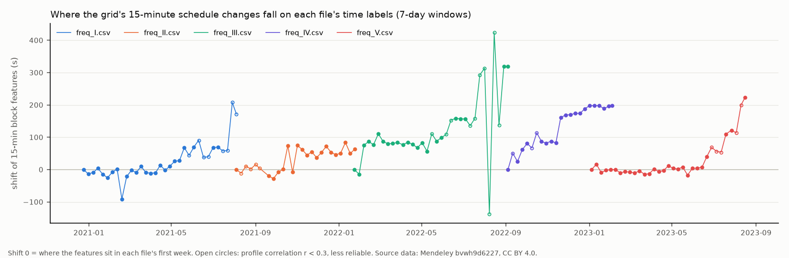

Figure: each line is one of the five source files; look at how its labels slide late in steps towards the end of the file, which is the drift that D corrects (`results/time_axis_check.json`).

## Data, licences and attributions

**Reference dataset.** Mukherjee, D., Kalita, K. and Kumar, S. (2024). *PMU-Frequency Data at 1-second Interval (December 2020- July 2024)*. Mendeley Data, version 4. https://doi.org/10.17632/bvwh9d6227.4. Licence CC BY 4.0 (https://creativecommons.org/licenses/by/4.0/). One-second grid frequency from the Grid-India NERLDC PMU at substation BALIP_PG, shared by IIT Guwahati.

- Version 4 is the version the dataset page showed on 7 Nov 2026; the version was not recorded at download time. The SHA-256 of each file used is in `results/reference_summary.md`, and the files were compared with Mendeley's published hashes before the build.
- The page title gives the period as December 2020 to July 2024. The five files used here run from <!-- span:start -->20 Dec 2020 to 20 Aug 2023<!-- span:end -->.
- Changes made: the five CSV exports were merged into one one-second float32 series; the exporter's Java error trace at the end of three files was removed; empty or non-numeric values were marked missing; where files overlap, the later file's value is used (`scripts/build_reference.py`). The built arrays are not redistributed here.

**Stream metadata and traces.** Public YouTube pages, read with yt-dlp (no sign-in, no cookies). The repo holds video IDs, titles and other public metadata (`data/`), SHA-256 hashes of the downloaded audio, and 1-Hz traces derived from it (`traces/`). No audio or video is included. <!-- test-licences:start -->Of the 150 Test streams, 3 carry a Creative Commons BY licence and 147 the standard YouTube licence<!-- test-licences:end --> (`results/splits_summary.json`).

**Software and services.** Every third-party library imported by `gunj/`, `scripts/` and `video/`, plus the tools and services they call:

| software | used for | licence |
|---|---|---|
| NumPy | arrays and numerics | BSD-3-Clause |
| SciPy | FFTs (`scipy.fft`), resampling, filters | BSD-3-Clause |
| pandas | time handling, CSV | BSD-3-Clause |
| matplotlib | result plots | Matplotlib licence (PSF-based, BSD-compatible) |
| soundfile (python-soundfile, using libsndfile) | reading audio | BSD-3-Clause; libsndfile LGPL-2.1 |
| yt-dlp | metadata and audio download (harvest only) | Unlicense |
| FFmpeg | decoding and conversion to 1 kHz mono (harvest, and `gunj/audio.py` for formats soundfile cannot read); encoding the demo video | LGPL-2.1 or later; some builds GPL |
| pytest | tests | MIT |
| setuptools | build backend for `pip install -e .` | MIT |
| Git | blinding check in `scripts/eval_common.py` and the frozen-extractor check in `scripts/harvest.py` (both call `git`) | GPL-2.0 |
| Python standard library | everything else | PSF licence |
| IBM Plex Sans, IBM Plex Mono | explorer site fonts and video captions, loaded from Google Fonts | SIL Open Font License 1.1 |
| Playwright, with its Chromium build | screenshots of the explorer in `docs/screens`, the frames of the demo video (`video/make_video.py`) and printing the PDF report (`scripts/build_report.py`); not part of the pipeline | Apache-2.0 |
| pypdf | title and author metadata of the PDF report (`scripts/build_report.py`) | BSD-3-Clause |
| PyMuPDF | checks of the PDF report: page count, embedded fonts, text size (`scripts/build_report.py`; the report is not built with it) | GNU AGPL-3.0, or Artifex commercial licence |
| Cambria, Consolas | text and code fonts of the PDF report, embedded as subsets (their embedding flag permits it) | Microsoft fonts supplied with Windows, used under the Windows licence terms |
| Pillow | crossfades between frames of the demo video (`video/make_video.py`) | MIT-CMU |
| faster-whisper (CTranslate2) with the Whisper large-v3 model, run offline | finding where each of the 11 narration lines starts and ends in Shrey's one-take recording, so it could be cut into lines for `video/place_voice.py` (a one-off step; the recording is not in the repo) | MIT (faster-whisper, CTranslate2 and the Whisper weights) |
| edge-tts, run with uvx and calling Microsoft Edge's online text-to-speech | optional synthetic narration voice (`video/tts_narration.py`); not used in the submitted video | edge-tts LGPL-3.0; the voice is a Microsoft online service |
| GitHub Pages, deployed by `.github/workflows/pages.yml` | hosting the explorer | hosted service under GitHub's terms |

## Limitations

- **The open reference ends on <!-- span-end:start -->20 Aug 2023<!-- span-end:end -->.** Gunj cannot check a recording made after that. Grid-India records the frequency every second; publishing that record would let recordings since 2023 be checked the same way.
- **Most streams carry little usable hum,** and a missing hum says nothing about a recording. The M1 hum flag was set for <!-- lim-hum:start -->50/126 (39.7%, 95% CI 31.6 to 48.4%)<!-- lim-hum:end --> of the Test streams with audio, and the share differs by venue type (Results, M1).
- **A confident verdict can be wrong.** <!-- lim-confident:start -->In the primary cell 9 of the 23 confident verdicts are more than 30 s from T*, which is 10.0% of the 90 excerpts (95% CI 5.4 to 17.9%): 6 by 30 to 120 s, 1 by 120 to 600 s and 2 by more than 600 s<!-- lim-confident:end -->. An offset of tens of seconds can come from YouTube's start time, the latency L, the drift estimate D or the lock itself, and this evaluation cannot tell them apart. A verdict should be read together with its candidate list and its margin.
- **False matches happen, and the negatives are few.** <!-- lim-false-match:start -->In the primary cell 1 of the 16 real foreign 60-min excerpts reached tau (6.2%, 95% CI 1.1 to 28.3%), above the 1% target; with the 20 SYNTHETIC ones added the count is 1/36 (2.8%, 95% CI 0.5 to 14.2%)<!-- lim-false-match:end -->. tau sits just above the largest confidence among the threshold-half negatives of each cell, so it rests on those recordings alone, and foreign recordings can correlate strongly with some stretch of the Indian log (Results, threshold tau).
- **The drift correction D is itself an estimate,** from a statistical clock with unknown error. Results without D (S1) and on label-stable streams only (S2) are reported beside the main ones.
- **The ground truth is YouTube's public start time** plus a latency L estimated from a handful of Calibration streams. Archives that may not start at that time (12-hour archive caps) were excluded in advance.
- **The Test harvest is partial, and it ended on a bot check.** <!-- harvest-count:start -->126 of the 150<!-- harvest-count:end --> selected Test streams were harvested. <!-- harvest-losses:start -->Of the other 24, 10 were no longer available on YouTube, 8 failed in download or conversion and could still have been retried when the harvest stopped (`data/harvest_manifest.csv`), 5 had not been attempted and 1 met the bot check (`results/flow_table.md`)<!-- harvest-losses:end -->. The harvest met <!-- bot-check:start -->1 bot check (8 Nov 2026, 05:30 IST)<!-- bot-check:end --> and stopped there, as PROTOCOL section 17 requires, which is why the harvest-health condition of the gate failed (Deviations). Streams were attempted in a seeded random order, so those attempted are a random sample of the Test split. Failures are not random in the same way: they may cluster by channel or stream format.
- **One measurement point.** The reference is a single PMU, which the dataset page places at NERLDC in Meghalaya (the files name substation BALIP_PG). India's grid is synchronous, but local events at that substation could differ from what a recorder elsewhere sees.
- **Edit detection was tested on SYNTHETIC cuts only.** <!-- lim-m5:start -->14/28 (50.0%, 95% CI 32.6 to 67.4%) of the SYNTHETIC cuts were detected, and none of the 3 SYNTHETIC cuts of 10 s<!-- lim-m5:end --> were found. No recording with a real edit was tested.
- **M4 is a simulation, and its answer depends on how the noise is read.** Its noise is SYNTHETIC. Read at the noise measured on the Test streams that lock, computed as pre-registered, the shortest tested length for 90% unique locks over the full span is <!-- lim-m4:start -->40 min at 37.4 mHz (20 min falls short); an EXPLORATORY (post hoc) reading with v2's weighted correlation gives 10 min at 9.4 mHz<!-- lim-m4:end -->. That noise is measured only on streams that lock, so it describes recordings with usable hum.
- **Not run:** the libhum baseline (libhum was never installed; PROTOCOL section 19) and the optional M6 station.
- **Some work came after the Test results.** The scoring of M5 on SYNTHETIC cuts, the plots and the M4 reading were computed with the Test results known. Two analyses, and the M4 readings other than the computation of `scripts/probe_noise.py`, are EXPLORATORY (post hoc); Deviations lists them.
- `gunj date` differs from the evaluated pipeline (Setup, step 3). Everything was run on one Windows laptop.

## Ethics and exclusions

- **Courts are excluded.** The Gujarat High Court Live Streaming Rules 2021 bar copying and derivative use of its feeds, so court channels and court proceedings are left out, and `scripts/make_splits.py` also screens titles for court words in English and Hindi (PROTOCOL section 4). The 5 Nov feasibility probe used a lecture on the Gujarat High Court's channel before this rule was written. That clip is excluded from every split, its audio is not on disk, and only the probe's printed outputs are in `docs/probe`.
- **Time and grid only.** Gunj never reports a location within India.
- **Audio is deleted after extraction.** The harvester downloads only the first 65 min of audio at the lowest bitrate, without sign-in, cookies or proxies, with sleeps between requests, and stops at the first bot check, CAPTCHA, sign-in wall or HTTP 429. It met <!-- bot-check:start -->1 bot check (8 Nov 2026, 05:30 IST)<!-- bot-check:end --> and stopped. The blocked stream was never retried, and no sign-in, cookies or proxies were used afterwards (Deviations describes the one later retry of the negatives). Each file is deleted once its traces are extracted. The exception is the 1 kHz audio of the 5 Dev streams, kept on the laptop for tuning; it is never committed or uploaded and is deleted when the project ends (PROTOCOL section 17).
- **No re-hosting.** No audio or video is in the repo, the explorer or the video. The v1 video uses no stream audio at all. Its narration is Shrey's own voice: the lines of `video/NARRATION.md`, recorded on a phone in one take, cut into lines and placed at their captions with `video/place_voice.py`.
- **YouTube's terms restrict downloading.** Audio was downloaded only with Shrey's approval (7 Nov 2026, 01:20 IST, and 10 Nov 2026 for the one retry of the report-half negatives), only from public institutional streams, and only to measure the method.
- **Dual use.** Dating a recording can reveal when someone was present at an event. Gunj is meant for checking claims about public recordings, and the explorer shows only public institutional streams.

## Related work

ENF (electric network frequency) analysis is an established forensic method. Grigoras (2005) proposed the ENF criterion for dating and authenticating digital audio. Huijbregtse and Geradts (2009) studied how short a recording can be and still be dated. Rodríguez, Apolinário and Biscainho (2010) located edits from discontinuities in the ENF phase. Garg et al. (2013) recovered ENF from video through the flicker of mains lighting, and Hajj-Ahmad, Garg and Wu (2015) identified which grid a recording came from. Kim, Jeon and Yoon (2017) built a national-scale ENF map from online multimedia. The work on Indian ENF that we found in a search on 5 Nov 2026 stops at identifying the grid of origin, for example among entries to the IEEE Signal Processing Cup 2016.

Open tools exist. [libhum](https://github.com/RaphaelJ/libhum) (LGPL) extracts ENF and matches it against a frequency history that the user supplies. [Hum Catcher](https://pypi.org/project/hum-catcher/) also needs a user-supplied reference. [openENF](https://www.npmjs.org/package/openenf) covers European grids. Robert Heaton's [write-up](https://robertheaton.com/enf/) explains the method for a general reader.

How Gunj differs:

- **An open Indian reference.** Gunj builds a one-second series from the public Grid-India data on Mendeley, maps its gaps, and can be rebuilt from the published files and their hashes.
- **A pre-registered evaluation.** Splits, seeds, metrics, the threshold rule and the hit rule were committed before any Test audio existed. Every later change to them is listed in PROTOCOL section 19, and every Test stream is reported, including failed downloads, streams without hum and wrong locks.
- **Label-drift correction.** The reference's own time labels drift by minutes. Gunj measures the drift against the grid's 15-minute scheduling clock and corrects each stream. We have not seen this problem described for this dataset.
- **No verdict by design.** The confidence is a margin over the best wrong candidate, with a threshold fixed on held-out foreign 50 Hz recordings and SYNTHETIC noise. Without hum, or below the threshold, Gunj says "no verdict".

What Gunj does not show: how it compares with another ENF tool. The libhum comparison on the same traces, planned in PROTOCOL section 12, was not run (PROTOCOL section 19), so the only comparisons are with Gunj's own v1 extractor, a naive single-bin extractor and chance.

References:

1. Grigoras, C. (2005). Digital audio recording analysis: the Electric Network Frequency (ENF) Criterion. *International Journal of Speech, Language and the Law* 12(1).
2. Huijbregtse, M. and Geradts, Z. (2009). Using the ENF criterion for determining the time of recording of short digital audio recordings. *Computational Forensics (IWCF 2009)*, LNCS 5718, Springer.
3. Rodríguez, D. P. N., Apolinário, J. A. and Biscainho, L. W. P. (2010). Audio authenticity: detecting ENF discontinuity with high precision phase analysis. *IEEE Transactions on Information Forensics and Security* 5(3).
4. Garg, R., Varna, A. L., Hajj-Ahmad, A. and Wu, M. (2013). "Seeing" ENF: power-signature-based timestamp for digital multimedia via optical sensing and signal processing. *IEEE Transactions on Information Forensics and Security* 8(9).
5. Hajj-Ahmad, A., Garg, R. and Wu, M. (2015). ENF-based region-of-recording identification for media signals. *IEEE Transactions on Information Forensics and Security* 10(6).
6. Kim, H., Jeon, Y. B. and Yoon, J. W. (2017). Construction of a national scale ENF map using online multimedia data. *CIKM 2017*, ACM. https://doi.org/10.1145/3132847.3132982
7. IEEE Signal Processing Society (2016). IEEE Signal Processing Cup 2016: Exploring power signatures for location forensics of media recordings. Competition page: https://signalprocessingsociety.org/community-involvement/ieee-signal-processing-cup-2016
8. Wilson, E. B. (1927). Probable inference, the law of succession, and statistical inference. *Journal of the American Statistical Association* 22(158).
9. Mukherjee, D., Kalita, K. and Kumar, S. (2024). PMU-Frequency Data at 1-second Interval (December 2020- July 2024). Mendeley Data, V4. https://doi.org/10.17632/bvwh9d6227.4
10. Gujarat High Court Live Streaming of Court Proceedings Rules 2021: https://gujarathighcourt.nic.in/pdf/LiveStreamingRules.pdf

## Deviations from the pre-registered plan

PROTOCOL section 19 records every change to the method, the data, the metrics, the thresholds and the gate made after the plan was approved, with the time, the reason, and whether any Test result had been seen. The entries of 7 Nov were all made before any Test search had run. The entries of 8, 10 and 11 Nov came after the gate result was known; they change no Test result, and they leave tau, L and the hit rule as they were. In short:

- **7 Nov, 08:30 IST, before approval.** Dev and Calibration audio were harvested before the plan was approved, under Shrey's 01:20 IST go-ahead for audio downloads. v2 was tuned on Dev only and frozen at 05:55 IST. Calibration traces were searched before tau existed; L was set only once tau was committed. The four local commits were rewritten at about 08:50 IST, before any push, to remove absolute local paths and edit the commit messages; no code changed. The fixed harvest order of PROTOCOL section 14 step 3 was added at the same time, because downloads were slower than planned.
- **7 Nov, 10:00 IST. Test harvest order.** `data/splits.csv` is sorted by date, so harvesting it in row order would have taken the oldest streams first. The Test harvest uses a seeded order (SHA-256 of the split seed and the video ID), so the streams finished by the gate are a random sample.
- **7 Nov, 11:50 IST. Network outage.** The laptop lost its connection from 10:18 to 11:38 IST. A tau written from 1 real and 20 SYNTHETIC negatives during the outage was deleted before it was committed or used. Network loss no longer counts as a failed download.
- **7 Nov, 12:15 and 12:30 IST. Fixes from a code review** of the harvester (YouTube's rate-limit wording, private videos, ffmpeg skipping a failed segment, network checks, a stop after 4 unexplained failures) and of the evaluation script (path redaction, network-down rows, judging harvest health from the append-only logs, freezing the gate once). The download attempts charged during the outage were given back to 182 manifest rows (`scripts/repair_outage_attempts.py`, `data/attempt_repair_20261107.json`). The rules for tau, L, hits and the gate did not change.
- **7 Nov, 22:40 IST. The gate moved from Saturday 7 Nov 22:00 IST to Sunday 8 Nov 14:00 IST.** The harvest ran far slower than planned: the outage, then an unstable mobile hotspot, then a self-stop of the harvester at 14:57 after 4 failures in a row (the logs show dropped connections, no block; restarted at 16:36). tau was computed at 17:44 but committed only at 22:35, with L, because the background check that watched for tau had been stopped for low memory. By the text of section 15, the 22:00 gate was therefore not met, and the only reason was that tau and L were not committed in time. Shrey agreed at about 22:30 IST to move the decision time. Everything else in section 15 is unchanged, and no Test search had been run. The heading of `results/gate.md` still names 7 Nov 22:00, because the script's heading text was frozen with it; the decision time it applies (8 Nov 14:00) is printed in the paragraph below the heading.
- **8 Nov, 17:10 IST. The gate result, and the decision to stay with Gunj.** The frozen gate run found <!-- gate-count:start -->38 of N = 126 Test streams locking blind (9 with D = 0)<!-- gate-count:end -->, so conditions 1 and 2 were met. Condition 3, that harvesting still works, was not met: at 05:30 IST YouTube answered a Test stream with "Sign in to confirm you're not a bot", and the harvester stopped as section 17 requires. By section 15 the gate is therefore not met, and the plan was to switch to the fallback project. Shrey decided at about 17:08 IST to stay with Gunj, because <!-- harvest-count:start -->126 of the 150<!-- harvest-count:end --> Test streams were already harvested and the evaluation needed no further download. No sign-in or cookies were used at any point. At that time no report-half real negative had been harvested, so M3 rested on SYNTHETIC negatives alone. The scoring loop had stopped at 07:31 IST, so the gate run took place at 17:04, later than the planned 14:10. The harvest had stopped at 05:30, so a run at either time counts the same streams.
- **10 Nov, 19:18 IST. One retry of the report-half real negatives.** Shrey decided to retry those streams once, about 62 hours after the bot check, with the same harvester and rules: signed out, no cookies or proxies, the same sleeps, and a stop for good at the first block. The blocked Test stream was not retried, and no Test stream was touched.
- **11 Nov, 18:36 IST. Outcome of the retry, and the libhum baseline.** The retry ran on 10 Nov from 19:19 to 19:58 IST and harvested <!-- neg-retry:start -->24 of the 25<!-- neg-retry:end --> streams. The remaining video was no longer available, and no block was met. M3 was then recomputed by the frozen `scripts/evaluate.py` with the frozen tau. The libhum baseline of section 12 was not run: libhum was never installed, and the time went to the harvest problems above. It is reported as "not run".
- **11 Nov, 22:52 IST. Analyses written after the Test results were known.** `scripts/m5_edits.py` and `scripts/make_figures.py` were written on 11 Nov, after the frozen evaluation had scored the Test streams. From the frozen scoring outputs they compute M5 on the SYNTHETIC cuts, the M2 and M3 plots and the M4 reading at the measured noise level that section 11 promises, and the confident-verdict breakdown from the pre-registered 30 s, 120 s and 600 s hit columns. They change no tau, L, hit, verdict or gate. Where section 11 leaves room for more than one reading, the reading chosen is stated in the script's docstring and in `results/m5.md` or `results/m4_measured.md`. Two analyses that section 11 does not contain are labelled EXPLORATORY (post hoc) wherever they appear: what goes with confident verdicts 30 to 600 s from T*, and M5 over all gate locks.

This README, the report and the explorer also label as EXPLORATORY (post hoc) the M4 readings that differ from the computation of `scripts/probe_noise.py`, which section 11 names: reading A, with v2's weighted correlation, and the other definitions of "streams that lock" (`results/m4_measured.md`). Reading B, the computation of `scripts/probe_noise.py`, is the M4 result.

## Disclosure

Gunj was built from 6 to 12 Nov 2026 by Shrey Sati, who chose the project, approved the audio download and approved the pre-registration commit (PROTOCOL section 18). A feasibility probe was run on 5 Nov 2026, before the build started. Its scripts and printed outputs are in `docs/probe`, and its numbers are not part of any metric.

## Repository layout

- `gunj/`: the package (audio loading, extractors, matchers, reference access, SYNTHETIC generators, the `gunj` command).
- `scripts/`: every analysis and harvest script named above.
- `tests/`: the pytest suite.
- `data/`: candidate lists, `splits.csv` and the harvest manifest (metadata only).
- `traces/`: 1-Hz traces per split and stream. The Test files also hold the SYNTHETIC cut traces that M5 scores.
- `results/`: every result file, written by the scripts. `results/figures/` holds the plots, their captions and the numbers they draw; `results/search_cache/` holds the raw search outputs.
- `site/`: the static explorer, published to GitHub Pages by `.github/workflows/pages.yml`.
- `docs/gunj-report.pdf`: the report, with its source in `docs/report/` (`template.html`, filled by `scripts/build_report.py`). `docs/probe/`: the 5 Nov feasibility probe. `docs/screens/`: screenshots of the explorer.
- `PROTOCOL.md`: the pre-registered plan and its deviations.
- `video/`: the narration, the shot list and the scripts that build the demo video.
